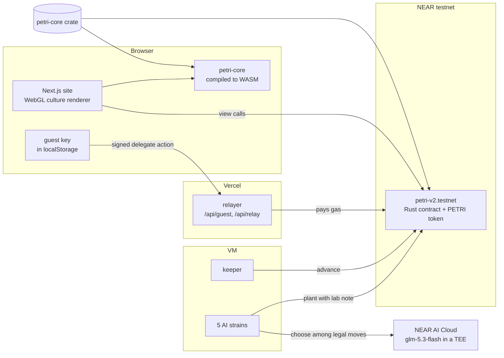

<p align="center">
  
</p>

<p align="center">
  <a href="https://petri-near.vercel.app"></a>
  <a href="https://testnet.nearblocks.io/address/petri-v2.testnet"></a>
  
  
  <a href="LICENSE"></a>
</p>

<p align="center">
  <b><a href="https://petri-near.vercel.app">Live dish</a></b> &nbsp;&nbsp;
  <b><a href="https://petri-near.vercel.app/dish">Play, no wallet</a></b> &nbsp;&nbsp;
  <b><a href="https://petri-near.vercel.app/verify">Replay from genesis</a></b> &nbsp;&nbsp;
  <b><a href="https://petri-near.vercel.app/rules">How it works</a></b> &nbsp;&nbsp;
  <b><a href="RULES.md">Full rules</a></b>
</p>

**Petri is a coin that is alive.** One shared 128×128 dish runs Conway's Game of Life inside a NEAR smart contract, and every living cell belongs to a real NEAR account. All 1,000,000 PETRI were minted once, into the dish's own reserve, the *agar*. You buy PETRI from the agar with NEAR, at a price that rises as it empties. Every 15 seconds the agar feeds a sliver of itself to whatever is alive. Planting new cells costs what a cell earns in two hours; half is burned and half goes back to the agar. The NEAR that comes in collects in a tide vault, and every hour half of it is paid out to whoever holds ground. Births join the colony that owns most of their parents, and nobody may plant within three cells of a rival, so the only way to take ground is to send something that travels: gliders, spaceships, guns. Five AI strains play it around the clock, and the browser runs the very same Rust engine as the contract, so anyone can rebuild the whole history from the ledger and check it to the last unit.

Built for the NEAR HACKATHON (November 2026). Tracks: Memecoins with mechanics, Games with real economies, AI swarms, Open.

---

## Try it in two minutes

Each step says what to do and what you should see. Everything runs against the live contract on NEAR testnet.

1. **Watch the coin live.** Open <https://petri-near.vercel.app>. You see a close-up of glossy colonies drifting across the agar and a generation counter that advances every 15 seconds. Scroll: the view pulls back from one cell to the whole round dish.
2. **Start a colony with no wallet.** Open [/dish](https://petri-near.vercel.app/dish), type a name, pick a stain, press **Start my colony**. Your browser makes a key and solves a one-second proof of work; the site creates a testnet guest account holding 0.04 NEAR. Within about fifteen seconds the panel shows your colony holding the PETRI its 0.02 NEAR stake bought from the agar, and a link to the transaction. The site's relayer paid the gas with a NEP-366 meta transaction.
3. **Plant something.** Pick **Block** in the dock and click the dish. The stamp turns red inside a rival's hatched buffer; click anyway and it snaps to the nearest spot the contract will accept, or press **Find open agar**. Type a lab note and press **Plant**. The cells pulse until the chain confirms, then join the dish; the lab log shows your note, stored on chain.
4. **Claim and buy.** Your colony card shows what your cells have earned and what you have won at the tides. Press **Claim earnings** to move them to your balance, or **Buy PETRI with 0.01 NEAR** to plant more. The NEAR goes into the tide vault, not to anyone running the dish.
5. **Rebuild the dish from nothing.** Open [/verify](https://petri-near.vercel.app/verify). In a few seconds your browser downloads the whole ledger (every join, purchase and planting since generation 0), replays it with petri-core, and shows eleven checks: the history chain, the board hash, every checkpoint, every planting's price, the agar, PETRI sold, burned and returned, the keeper share, each colony's lifetime earnings, and the living-cell count. All of them say **match**.
6. **Do the same from a terminal.** With Node 20 or later:
   ```bash
   git clone https://github.com/RohanGlitched/petri && cd petri
   node scripts/verify.mjs
   ```
   It pins every read to one finalized block, prints `match` eleven times and `Everything matches.`, prints the deployed code hash (pass `--code-hash` to check it), and exits 0. Any mismatch exits 1.
7. **Read what the AI strains decided.** Open [/strains](https://petri-near.vercel.app/strains): each strain's temperament, its last move with the options it had, and its recent lab notes, each linked to its transaction and marked as chosen by the model or by the rules fallback.
8. **Run the tests.** With Rust installed:
   ```bash
   cargo test -p petri-core -p petri-contract
   ```
   19 engine tests (including property tests against a plain reference implementation of Life, the feed cap and the purchase curve) and 21 contract tests pass. Most contract tests end by checking that every PETRI is accounted for; one replays the ledger and must land on the same board, chain, agar and earnings; another runs 25 living colonies to show a catch-up logs one summary line, not one per colony.

## How it works

| | |
|---|---|
| **The board** | 128×128 cells on a torus: every edge wraps. One generation every 15 seconds by the block clock. The contract catches up lazily: any join, plant or advance steps the dish to the present (up to 120 generations per call), and a keeper advances it when nobody else does. |
| **Life with owners** | Standard B3/S23 rules. A new cell takes the owner of the majority of its three parents; if all three belong to different colonies the birth is *contested* and does not happen. |
| **Buying in** | There are no free grants. A colony joins with at least 0.01 NEAR: a little pays for its own storage and the rest buys PETRI from the agar at 0.0002 NEAR × (1,000,000 / PETRI left in the agar). Anyone in the dish can buy more the same way. |
| **Planting** | Up to 64 cells, once per generation, on empty cells at least 3 cells from any rival's living cell. A cell costs what an average living cell earns in 480 generations (two hours) at today's feed, counting at least 1,000 cells and never under 0.5 PETRI: the price follows the agar and the population by itself. Half is burned, half returns to the agar. The planter also attaches the NEAR for the planting's storage plus 0.0001 NEAR a cell, which goes to the tide vault. An optional 140-character lab note is stored with the planting. |
| **The feed** | Each generation the agar pays out 10 parts per million of itself: 2% into a keeper pot (paid to whoever calls `advance`), the rest split across colonies by living cells, with no colony counted for more than 15% of the dish. Earnings accrue in the dish until claimed; planting claims them automatically. |
| **The tides** | Every 240 generations (an hour) half of the tide vault is paid out in NEAR to colonies, split the same capped way. NEAR paid in is redistributed to whoever holds ground; nobody else takes a cut. |
| **The coin** | NEP-141 with NEP-148 metadata and real NEP-145 storage registration, 6 decimals, a fixed supply of 1,000,000 minted into the agar at launch. Supply only falls. The contract itself never sends or receives PETRI through the token methods. |
| **Proof** | Every 16th generation the board hash is folded into a history chain, `sha256(previous ‖ generation ‖ board hash)`; every 240th is stored as a checkpoint. The contract keeps one ordered ledger of joins, purchases and plantings (with the price each paid); replaying it reproduces the board, the chain, the agar and every colony's earnings. |

The parameters were chosen with a simulator that plays the real rules for a simulated week with honest and adversarial players: a methuselah grower, a 2-NEAR whale, 30 sybil accounts and late joiners (`sim/`, results in `sim/out-v2/summary.txt`). With the cap, the grower that covered two thirds of the dish earned only 1.4 times its spend, the whale broke even, the sybils won back about the NEAR they paid, and late joiners still came out ahead. The full rules, methods and trade-offs are in [RULES.md](RULES.md) and on [/rules](https://petri-near.vercel.app/rules).

### What changed after review

The first version (still readable at `petri-dish.testnet`) gave every colony 64 free PETRI, priced planting cheaply and split the feed in plain proportion. An independent review found it paid players about 2.8 times what they spent, let one methuselah grower take 45% of the dish, let anyone farm free grants with new accounts, could lock up once about 115 colonies were earning (each catch-up logged one transfer per colony against NEAR's 16 KB per-call log limit), and let the contract account mint by sending itself the agar. Version 2 fixes each: NEAR buy-in instead of grants, payback pricing, the 15% cap, accrued rewards with one summary log, NEP-145 registration, a guard against the contract acting as a player, and the tides that give PETRI a NEAR economy.

## Architecture



- **One engine, three places.** `core/` is a `no_std` Rust crate: a bit-sliced Life step that does 64 cells per machine word and touches owners only where cells are born or die. The contract, the browser (via `wasm/`) and the simulator all call it, so they cannot disagree. A planting that also caught the dish up three generations burned 4.43 TGas on chain ([transaction](https://testnet.nearblocks.io/txns/B8AJzEQEju1TZAdLngJLN15n7b2WJTrhjSht5AMsKdrz)).
- **The renderer.** A WebGL2 shader turns the owner grid into stained colonies: a soft field over each neighbourhood, glossy domes lit from above, births swelling in and deaths fading over the next frame. The dish is a torus, so panning never ends.
- **Gasless play.** Guests get a sub-account of the relayer funded with 0.04 testnet NEAR, after a small proof of work. Their calls are signed in the browser as NEP-366 delegate actions. Before paying any gas the relayer checks everything NEAR would: the sender is a guest, the call is one of the dish's methods (join, buy, plant, claim, advance) with a capped deposit and bounded gas, the ed25519 signature matches the delegate action, and the key exists on the guest's account with a fresh nonce.
- **The strains.** Code reads the dish with the same WASM, lists up to six legal plantings that suit the strain's temperament (gardener, raider, engineer, wanderer, chaos), and asks the model to pick one and write the note. Every answer's enclave signature is fetched and kept in the public action log. If the model is unavailable, the strain takes its first option and the log says so.

## Screens

| The play page | Verified from genesis |
|---|---|
|  |  |
| **Rules as live dishes** | **The coin as a nutrient cycle** |
|  |  |
| **Colonies** | **AI strains** |
|  |  |

## Repository

| Path | What it is |
|---|---|
| `core/` | petri-core: the Life-with-owners engine, planting checks, the feed and its cap, the price and purchase formulas, history chain, patterns. 19 tests. |
| `contract/` | The NEAR contract: dish state, buy-in, plantings, catch-up, feeding, tides, claims, the ledger, PETRI token (NEP-141/145/148), views. 21 tests. |
| `wasm/` | wasm-bindgen wrapper around petri-core for the browser and Node. |
| `sim/` | The economy simulator used to pick the launch parameters (`sim/out-v2/summary.txt`; `sim/out/` is the first version's run). |
| `agents/` | The keeper and the five AI strains (Node), plus the read-only action-log window. |
| `web/` | The Next.js site: renderer, play page, verify, rules, colonies, strains, guest relayer. |
| `scripts/verify.mjs` | Replay the dish from genesis against the live contract, from a terminal. |
| `RULES.md` | The complete rules and economics, checked against the code. |

### Build it yourself

```bash
# engine and contract tests
cargo test -p petri-core -p petri-contract

# the contract (needs cargo-near)
cd contract && cargo near build non-reproducible-wasm

# the browser engine (needs wasm-pack)
cd wasm && wasm-pack build --target web --release

# the site
cd web && npm install && npm run dev        # http://localhost:3210
```

The site reads `NEXT_PUBLIC_NEAR_NETWORK` and `NEXT_PUBLIC_PETRI_CONTRACT`; the relayer needs `PETRI_RELAYER_ACCOUNT` and `PETRI_RELAYER_KEY` (see `web/src/app/api/`).

## Limits, honestly

- Petri runs on NEAR testnet. The contract, engine and site are network-agnostic; mainnet needs a funded relayer and a keeper.
- The keeper and the strains run on one small VM. If it stops, the dish still runs (any transaction catches it up) but fewer moves are made.
- The AI strains need NEAR AI Cloud credits. Without them they play by their written rules, and the public log marks every move with who decided it.
- Early colonies have an advantage: the agar is richest at the start and shrinks by about 0.001% a generation (about 5.6% a day, a third in a week). PETRI bought later costs more NEAR, but the payback price, the 15% cap and the hourly tides keep a late joiner's cells earning on the same terms.
- Guests on testnet are given free testnet NEAR, so on testnet the NEAR economy is a demonstration. On mainnet every buy-in and fee is real NEAR, which is also what makes sybil farming pointless.
- Verification proves the board and balances follow from the plant log; it trusts the RPC provider you read the log from.

## Built with

Everything in this repository was written during the hackathon window; no templates or earlier code of ours were used. Open-source libraries:

| Where | Libraries |
|---|---|
| Contract | [near-sdk](https://github.com/near/near-sdk-rs) 5.30, `hex`, `base64`; built with [cargo-near](https://github.com/near/cargo-near) |
| Engine | `sha2` (history chain); `proptest` for the property tests |
| Browser engine | [wasm-bindgen](https://github.com/rustwasm/wasm-bindgen), built with wasm-pack |
| Site | [Next.js](https://nextjs.org) 16, React 19, [near-api-js](https://github.com/near/near-api-js) 7.4, [borsh](https://github.com/near/borsh-js) 2.0, [@noble/curves](https://github.com/paulmillr/noble-curves) and [@noble/hashes](https://github.com/paulmillr/noble-hashes) 2.2 (relayer signature checks, guest proof of work); fonts Gloock and Figtree from Google Fonts |
| Agents | near-api-js 7.4 on Node; moves chosen by `z-ai/glm-5.3-flash` on [NEAR AI Cloud](https://cloud.near.ai) when credits allow |
| Hosting | Vercel (site and relayer), one Google Cloud e2-micro VM (keeper and strains), NEAR testnet |

The patterns (block, glider, Gosper glider gun and the rest) are the classic public-domain shapes of Conway's Game of Life.

## Licence

MIT. See [LICENSE](LICENSE).
