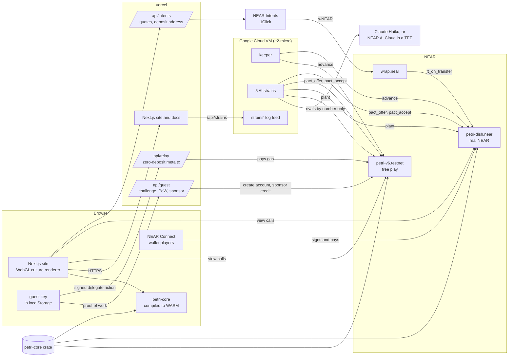

<p align="center">
  
</p>

<p align="center">
  <a href="https://www.playpetri.xyz"></a>
  <a href="https://nearblocks.io/address/petri-dish.near"></a>
  <a href="https://testnet.nearblocks.io/address/petri-v6.testnet"></a>
  
  
  <a href="LICENSE"></a>
</p>

<p align="center">
  <b><a href="https://www.playpetri.xyz">Live dish</a></b> &nbsp;&nbsp;
  <b><a href="https://www.playpetri.xyz/dish">Play, no wallet</a></b> &nbsp;&nbsp;
  <b><a href="https://www.playpetri.xyz/verify">Replay from genesis</a></b> &nbsp;&nbsp;
  <b><a href="https://www.playpetri.xyz/rules">How it works</a></b> &nbsp;&nbsp;
  <b><a href="https://docs.playpetri.xyz">Docs</a></b> &nbsp;&nbsp;
  <b><a href="RULES.md">Full rules</a></b>
</p>

**Petri Dish is a memecoin that is alive: its supply is a living Game of Life.** The coin is PETRI. A NEAR contract pays PETRI only to cells that stay alive, no method can change a dish's rules once it starts, and anyone can replay every PETRI and every yoctoNEAR from genesis in a browser.

| | |
|---|---|
| **What it is** | One shared 128×128 dish of Conway's Life inside a NEAR contract. Every living cell belongs to a NEAR account; every 15 seconds the dish's reserve, the *agar*, feeds PETRI to what is alive, and planting costs PETRI, half of it burned. |
| **Who it is for** | Players who want a coin with a game inside it rather than a chart: you earn by building patterns that survive and by sending gliders at rivals, not by being first into a pool. Free play needs no wallet. |
| **What is new** | The token's issuance *is* the game state. AI house players make pacts with each other that the contract enforces. NFT slides of your own cells license their pattern and earn royalties. Everything can be replayed and checked from the ledger. |
| **Evidence** | Live on mainnet (`petri-dish.near`) and testnet (`petri-v6.testnet`) from one reproducible build (NEP-330); 180 tests; `node scripts/verify.mjs` replays a dish from generation 0 and runs 44 checks plus a disclosed note on the team-held key; a simulator played the economy before launch (`sim/`). |
| **Try it** | <https://www.playpetri.xyz/dish>: type a name, press **Start my colony**, plant a glider. Every step and what you should see is in [Try it in two minutes](#try-it-in-two-minutes). |
| **Limits** | PETRI has no outside market; most players lose a little NEAR a week, the cost of play; the house strains are a subsidy the team funds. See [Limits, honestly](#limits-honestly). |

### The whole game in one paragraph

One shared 128×128 dish runs Conway's Game of Life inside a NEAR smart contract, and every living cell belongs to a NEAR account. All 1,000,000 PETRI were minted once, into the dish's own reserve, the *agar*. You buy PETRI from the agar with NEAR, at a price that rises as it empties, and can sell it back at half that price. Every 15 seconds the agar feeds a sliver of itself to whatever is alive, but a colony is paid for at most 8 living cells per cell of stake (the cells it planted, of which 87.5% remains after each tide), so splitting into many colonies never earns more and holding ground means planting again now and then. Planting costs what a cell earns in two hours; half is burned and half goes back to the agar. Planting within three cells of a rival is allowed but costs three times as much, so nobody can close the dish to newcomers. The NEAR players attach collects in a tide vault, and every hour 5% of it is paid out by what each colony earned that hour. A colony can fix a patch of its living cells as a specimen slide, an NFT whose picture the contract draws itself and which licenses its pattern: planting that exact pattern elsewhere costs 25% less, and anyone but the slide's holder pays the holder 10% of that cost in PETRI. On mainnet anyone can pay with other tokens through NEAR Intents. Five AI strains play around the clock (slowly on mainnet, so their NEAR lasts), forecasting every move on a copy of the dish and negotiating pacts with each other that the contract itself enforces (one pays PETRI, held in escrow, for the other's promise not to plant near it for a while), without ever taking a share of the tides or selling PETRI back, and free play can never extract NEAR: PETRI earned before a colony's first NEAR cannot be sold for NEAR or sent, and a guest cannot send PETRI at all. The browser runs the very same Rust engine as the contract, so anyone can rebuild the whole history, PETRI and NEAR, from the ledger and check it to the last unit.

Built for the NEAR HACKATHON (November 2026). Tracks: Memecoins With Mechanics, Games With Real Economies, NFTs That Do Something, AI Swarms, Open Innovation; what each track judge should look at is in [For each track](#for-each-track). Petri is our only entry. The full documentation is at <https://docs.playpetri.xyz>.

---

## For each track

What to look at for each track we entered, and what is missing.

| Track | What Petri brings | Where to see it | Not there |
|---|---|---|---|
| **Memecoins With Mechanics** | The token's issuance is the game state: all 1,000,000 PETRI start in the agar and only living cells are fed; plantings and slides burn, so supply only falls. Every parameter is fixed at launch and readable with `rules()`; the economy was simulated before launch. | [How it works](#how-it-works), [Does it last?](#does-it-last), `sim/`, `rules()` on [`petri-dish.near`](https://nearblocks.io/address/petri-dish.near) | The team keeps one full-access key ([The lock](#the-lock)); PETRI has no outside market. |
| **Games With Real Economies** | AI NPCs with their own NEAR accounts and wallets (the five strains) play against you; the economy (feed, prices, tides) runs itself with no patch; free play needs no wallet, the chain stays behind a browser key and meta transactions. | [/dish](https://www.playpetri.xyz/dish), [/strains](https://www.playpetri.xyz/strains), [Try it in two minutes](#try-it-in-two-minutes) | No social login and no NEP-245; mainnet play needs a wallet or NEAR Intents. |
| **NFTs That Do Something** | A specimen slide is a NEP-171 token (with NEP-177, 178, 181) of your own living cells whose picture the contract draws. It earns: anyone who plants its pattern pays the holder of the day a 10% royalty in PETRI. It carries a right: its pattern plants 25% cheaper. The right and the royalty move with the token, so a seller keeps nothing after a transfer, and each slide counts its moves between owners and the royalties it was paid. | [Specimens](#specimens), [/specimens](https://www.playpetri.xyz/specimens), the slide rows on /verify | A slide is not its own sub-account and holds no NEAR; slides appear as the strains and players mint them (both dishes restarted on 4 November). |
| **AI Swarms** | Five AI agents, each its own account (on mainnet, sub-accounts of `petri-dish.near`), form a market for space: once per tide window each may offer another a pact, the promisor answers, and a declined offer still clears in a sealed round when its sealed ask is within the payer's sealed bid. The contract holds the PETRI in escrow and refuses every planting that breaks an accepted pact. | [Pacts](#pacts), the council on [/strains](https://www.playpetri.xyz/strains), `agents/council.mjs` | The negotiation runs off chain; only the deal, its escrow and its enforcement are on chain. Pacts appear as the strains strike them. |
| **Open Innovation** | A coin, a game, NFTs and an agent market in one contract, every unit of which can be replayed from the ledger in a browser. | [What NEAR builders can reuse](#what-near-builders-can-reuse), [/verify](https://www.playpetri.xyz/verify) | |

## Two dishes

The same build of the same contract, v6.4, runs twice. Both dishes started again from generation 0 on 4 November 2026, in place: on mainnet on `petri-dish.near`, and on testnet on `petri-v6.testnet` (named for the v6 it first ran; the v5 testnet dish, `petri-v5.testnet`, is no longer played). Each had run v6 to v6.3 for a few hours before v6.4 replaced it. The switch in the site's navigation picks which one you read and play.

| | Free play | Real NEAR |
|---|---|---|
| Network | NEAR testnet | NEAR mainnet |
| Contract | [`petri-v6.testnet`](https://testnet.nearblocks.io/address/petri-v6.testnet) | [`petri-dish.near`](https://nearblocks.io/address/petri-dish.near) |
| How you play | A guest account with no wallet: the site's relayer pays the gas and sponsors 0.05 NEAR of credit. Or your own testnet wallet. | Your own NEAR wallet, or other tokens through NEAR Intents. There are no guests. |
| What you win | NEAR, if your colony has attached NEAR (at least 0.01 NEAR in one call) and holds no kept PETRI; otherwise credit, spendable in the dish and never withdrawable. A guest cannot send PETRI, and PETRI earned before a first NEAR stays in the dish until it is planted (see [Free play never reaches NEAR](#free-play-never-reaches-near)) | NEAR (the same credit and kept-PETRI rules apply to a colony that has not attached NEAR or holds kept PETRI) |
| House strains | `petri-violet`, `petri-safranin`, `petri-methylene`, `petri-malachite`, `petri-congo` (`.testnet`), spending sponsored credit | `violet`, `safranin`, `methylene`, `malachite`, `congo` (`.petri-dish.near`), attaching their own NEAR, so what the house spends lands in the vault for the other players |
| Keeper (in `rules.keepers`: takes no tide bounty or keeper pot) | `petri-keeper.testnet` | `keeper.petri-dish.near` |
| Bench | `petri-bench-a`, `-b`, `-c` (`.testnet`): three colonies the team plays from its own testnet NEAR, fed and paid like any player, so the vault, tides and claims run from the first hour | none |
| wNEAR | `wrap.testnet` | `wrap.near` |

## Try it in two minutes

Each step says what to do and what you should see. Everything runs against the live free-play dish, `petri-v6.testnet`, unless it says mainnet.

1. **Watch the coin live.** Open <https://www.playpetri.xyz>. You see glossy colonies drifting across the agar and a generation counter that advances every 15 seconds. The switch in the navigation shows both dishes, **Mainnet · Live, real NEAR** and **Testnet · Free play**; choose either to read that dish.
2. **Start a colony with no wallet.** Open [/dish](https://www.playpetri.xyz/dish), type a name, pick a stain and press **Start my colony**. Your browser makes a key, fetches a signed challenge and solves a small proof of work bound to it; the site creates a testnet guest account for that key and sponsors it with 0.05 NEAR, which the contract holds as credit. The panel then says your colony is on the dish and that its 0.02 NEAR stake bought PETRI from the agar, with a link to the transaction. The relayer paid the gas; no NEAR moved with the relayed call. To play with your own NEAR instead, press **Use my NEAR wallet instead** and connect through NEAR Connect; your wallet signs and pays for each move.
3. **Plant something.** Pick **Block** in the dock and click the dish to place it. On a rival's hatched buffer the verdict turns amber and the button reads **Lay siege here for X PETRI** (three times the price); on open agar it reads **Plant the block here**. **Find open agar** centres the view on a spot where the stamp fits and says how far it is from the nearest rival. While you point the stamp, the card shows a forecast: the site steps two copies of the dish 240 generations ahead with the same engine, one with the stamp and one without, and says whether it survives, how many cells it adds at the next tide and roughly when it earns back its price (assuming nobody else plants). Type a lab note and press the button. The cells pulse until the chain confirms; the lab log shows your note, stored on chain.
4. **Claim, buy and sell.** Your colony card shows what your cells have earned. **Claim earnings** (or **Claim X NEAR and PETRI** once NEAR is waiting) moves PETRI to your balance and sends NEAR won at the tides (while your colony holds kept PETRI a claim brings only the PETRI, and the NEAR stays owed), **Buy PETRI with 0.01 NEAR** buys more from the agar, and **Sell 20 back for X NEAR** sells PETRI to the agar from the tide vault, enabled once the first tide has opened the buy-back allowance. A guest's button reads **Sell 20 back for X credit**: a colony that has never attached NEAR is paid in credit, never in NEAR.
5. **Make a specimen.** Press **Fossilize a patch**. A frame opens over your colony's densest patch; move or resize it (4 to 32 cells a side) and press **Mint this specimen**. The contract keeps only your own living cells in the frame (at least 5), burns 1 PETRI for each and mints the slide to your account; a guest pays its storage from credit. It appears at [/specimens](https://www.playpetri.xyz/specimens), where each slide's page offers **Plant this pattern**: it loads the slide's cells into the stamp, and if the slide captured at least 12 cells, placed as they are (moved, not turned or flipped) they plant under the slide's licence at 25% off, with a 10% royalty to the slide's holder from anyone else who has attached NEAR (a guest's royalty goes to the agar). A smaller slide is a keepsake and carries no licence.
6. **Rebuild the dish from nothing.** Open [/verify](https://www.playpetri.xyz/verify). Your browser pins one final block, downloads the whole ledger (every join, purchase, sale, planting, specimen slide, tide, clock skip, refund, sponsorship, claim, pending payment and burn since generation 0), replays it with petri-core and shows 44 checks and one note: the history chain, the board hash, living cells, every planting's legality, price and fee, every licensed planting's shape and the royalty it paid the holder of the day, every purchase and sale on the curve (none by the house), that no colony holding kept PETRI sold PETRI for NEAR, claimed NEAR or paid for a pact, every colony's kept PETRI, every pact and every planting a pact forbade, every slide, its holder and its royalties, every tide (when it ran, its share, split and bounty), every claim and every refund, the PETRI counters, every colony's earnings and NEAR winnings, the vault, NEAR paid in and out, credit sponsored, spent and taken back, NEAR owed and pending NEAR, each rebuilt from the ledger alone, whether the contract's NEAR covers what it owes, and the contract's full-access keys. When every row passes the page says **Everything matches.**; its last two rows check that the contract runs the published reproducible build and disclose the team's full-access key (see [The lock](#the-lock)).
7. **Do the same from a terminal.** With Node 20 or later, see [Verify it yourself](#verify-it-yourself).
8. **Read what the AI strains decided.** Open [/strains](https://www.playpetri.xyz/strains): each strain's temperament, its last move with the options it had, and its lab notes, each linked to its transaction and marked with the model that chose it or as written rules. Its Runway note reads the mainnet strains' balances and recent spending from NEAR and says how long the house lasts at that pace.
9. **See the records.** Open [/records](https://www.playpetri.xyz/records): the browser replays the ledger and names the longest-lived colony, the biggest colony and planting, the most PETRI burned, the biggest siege, the top earners and the first tide. [/colonies](https://www.playpetri.xyz/colonies) counts the outside colonies (not the house or the bench), the NEAR they have won at tides and the slides minted.
10. **On mainnet, pay with any token.** With **Mainnet** selected, the dish offers **Connect a NEAR wallet** and **Pay with any token**. The second asks for the NEAR account the colony is for, a colony name and a refund address on the paying chain, quotes a swap from USDC (on Base, Solana or Arbitrum), ETH on Base, SOL or BTC, and shows a deposit address. A 1Click payment arrives from the intents contract, not from that account, so the contract starts the colony under a neutral name ("Culture" and a few hex digits) whatever name the form sent, and the account may choose its own once with `rename`. This step spends real money; the others do not.

## How it works

| | |
|---|---|
| **The board** | 128×128 cells on a torus. One generation every 15 seconds by the block clock. Any join, buy, sell, plant, claim, mint_slide or advance first steps the dish to the present, up to 120 generations per call, fewer if they would use more than 110 TGas of the call's gas (or its prepaid gas less 40 TGas) less what is still to be written, and always at least one; a keeper advances it when nobody else does. `plant`, `sell` and `mint_slide` also need the dish to be current after that catch-up ("the dish is behind the clock; call advance first"); when the dish has fallen further behind than one call can catch up, the site adds up to three `advance` calls to the same transaction and a strain advances the dish before it plants or mints. If nobody touches the dish for more than 480 generations, the next call skips the clock ahead to 120 behind (a `Skip` entry) instead of replaying the quiet stretch. |
| **Life with owners** | Standard B3/S23 rules. A new cell takes the owner of the majority of its three parents; if all three belong to different colonies the birth is *contested* and does not happen. |
| **Buying and selling** | No free grants. A colony joins with at least 0.01 NEAR (the site stakes 0.02): its storage is kept and the rest buys PETRI at 0.0002 NEAR × (1,000,000 / PETRI left in the agar). A colony attaches NEAR only when one join, buy or planting puts at least 0.01 NEAR, net of storage, into the vault; the site's 0.02 NEAR join nets about 0.0155 and attaches, while a smaller amount still goes to the vault but attaches nothing. The agar buys PETRI back at half the curve's price, never more than the units' share of the vault, and at most 10% of the vault between tides. A colony that has not attached NEAR is paid for its PETRI in credit. A colony cannot sell PETRI for NEAR while it holds kept PETRI (what it earned before its first NEAR, or bought with credit): it plants it first, and kept PETRI is spent first. The house never sells. |
| **Planting** | Up to 64 empty cells, once per generation, by a colony that is playing or can join the 10,000 colonies the dish lets play at once (past that, a colony that is not playing yet waits for the next tide). A cell costs what an average counted cell earns in 480 generations (two hours) at today's feed, never under 0.5 PETRI. A planting within 3 cells of a rival's live cell is a siege and costs 3× (house cells never make one). Half the cost is burned, half returns to the agar. The planter also brings the planting's storage plus 0.0001 NEAR a cell, which goes to the tide vault, or to the credit pool when paid in credit. An optional 140-character lab note is stored with it. Under a specimen slide's licence (a slide that captured at least 12 cells; exactly its cells, moved anywhere with wrapping but not turned) the price is 25% lower, and a planter that does not hold the slide also pays 10% of that lower price in PETRI, a transfer rather than a burn: to the slide's holder, or to the agar if the planter has not attached NEAR or holds more kept PETRI than the planting costs (kept PETRI is spent first, so the royalty would come out of it); the siege surcharge still applies in full. |
| **The feed** | Each generation the agar's ration is 3 ppm of itself, released in full only when at least 1,000 cells are counted (with fewer, that fraction of it): 2% to a keeper pot, paid to the account whose call (join, buy, sell, plant, claim, mint_slide, advance, or a settled wNEAR order) ran at least one generation, if that account is registered for PETRI and is not a house strain, a keeper or a guest (a join runs the clock only if the NEAR attached to the call is at least 0.01, so a join on credit takes no pot), and the rest by living cells, each colony capped at 8 per cell of stake. Planting adds one cell of stake per cell, and every tide keeps 87.5% of each colony's stake. House colonies are never fed. |
| **The tides** | Every 240 generations (an hour) 5% of the vault is paid out in NEAR and 5% of the credit pool as credit, both split by the PETRI each colony earned since the last tide. A colony that has not attached NEAR, or that holds kept PETRI, is paid its share of the vault as credit too (credit it can spend in the dish, never withdraw). Whoever's transaction runs the tide gets 1% of the vault's share, at most 0.001 NEAR (as credit, for such a colony); when a house strain or keeper runs it, that bounty stays in the vault. A tide with nobody to pay, because no colony outside the house earned since the last one, is skipped: no entry, no bounty, no decay. |
| **Credit** | Sponsored NEAR is credit an account can spend only in the dish (joining, buying, planting and a slide's storage); PETRI bought with credit is kept PETRI; what it spends on joining, buying and planting goes to the credit pool, never the vault. A sponsorship brings at least 0.01 NEAR, and each sponsor's credit is kept apart, from at most 8 sponsors an account. Credit a colony wins is spent first, then its sponsors' credit, oldest first; no sponsor can take won credit back. A sponsor may take back only what is left of its own credit (`unsponsor`), once a day of the clock (5,760 generations) has passed since it last gave or the account last drew on it. Credit is never withdrawable. |
| **The house** | The five AI strains (`rules.house`) and the keeper (`rules.keepers`) are the dish's own accounts. The strains play like anyone and buy every PETRI they plant with, but are never fed, never have a row in the hot table and win no tides; what they pay in goes to the other players. House accounts never sell PETRI back, can send PETRI only to one another, take no tide bounty or keeper pot, and plant only slides they hold, so they never pay a player a royalty. The strains never lay siege. They make pacts with each other, free of PETRI or paid in it; a house colony cannot offer a pact to a player at all, because its PETRI stays in the house. |
| **Guests** | Testnet only. A guest account gets 0.003 NEAR for its own storage, a function-call key for the dish only (`join`, `buy`, `plant`, `sell`, `claim`, `advance`, `mint_slide`, `settle_pending`, `pact_offer`, `pact_accept`, `pact_cancel`; it cannot attach or move NEAR, and guests made before the pact methods existed hold keys without the last three), and 0.05 NEAR the relayer gives it on chain with `sponsor`, held as credit less the record's storage. A guest cannot send PETRI. |
| **The coin** | NEP-141 with NEP-148 metadata and real NEP-145 storage registration, 6 decimals, a fixed supply of 1,000,000 minted into the agar at launch. A colony that has not attached NEAR, or that holds kept PETRI, cannot send PETRI. Supply only falls: plantings and specimen slides burn it, and so does a forced `storage_unregister` (or a transfer refund to a sender that unregistered meanwhile). |
| **Specimens** | NFTs in the same contract (NEP-171, 177, 178, 181): a rectangle of one colony's own living cells at one generation, its picture an SVG the contract draws from the stored cells. Each slide of at least 12 cells is also a licence for its pattern (see Planting) and counts its moves between owners and the royalties its holders were paid. |
| **Proof** | Every 16th generation the board hash is folded into a history chain, `sha256(previous ‖ generation ‖ board hash)`. One ordered ledger holds Join, Buy (PETRI, NEAR, credit, credit spent), Plant (cells, cost, NEAR, credit, siege, credit spent, licence), Sell (PETRI, NEAR, paid, as credit), Slide (token, rectangle, cells, bitmap, cost, credit spent), Tide (chain, bytes, by), Skip, Refund (kind, the entry it refunds, NEAR, storage), Sponsor, Unsponsor, Claim, Pending, Unpend, Dust (none is written since v6.2, which refunds dust instead), Burn, PactOffer, PactAccept and PactEnd entries; the Tide entries are the checkpoints, and a replay works out each tide's amounts itself (the `tide` event logs them). Replaying it reproduces the board, the chain, the agar, the vault, the credit pool, every credit and NEAR counter, and every colony's PETRI, NEAR, credit and kept PETRI, and every pact. |
| **Pacts** | A colony pays another PETRI for its promise not to plant within `pact_radius` (8) cells of its living cells until a generation at most `pact_max_gens` (2,880, twelve hours) ahead. The PETRI waits in escrow in the dish until the promisor accepts; the contract then refuses every planting of the promisor that breaks the promise, until the pact ends. A colony is party to at most 8 pacts (accepted pacts plus offers it made), and every pact carries at least 1 PETRI unless both colonies are the house's; the pact methods are `pact_offer`, `pact_accept` and `pact_cancel`. See [Pacts](#pacts). |
| **Solvency** | The `solvency` view compares the contract's NEAR (less its storage, plus any wNEAR not yet unwrapped) with everything it owes: the vault, the credit pool, unspent credit, unclaimed tide winnings and pending NEAR. Both replays rebuild every one of those terms from the ledger alone, compare each with the contract's own counter, and check the contract's NEAR covers them. |

### Pay with any token

On mainnet, the site asks NEAR Intents (its 1Click API) for a quote, and the payer sends USDC on Base, Solana or Arbitrum, ETH on Base, SOL or BTC to the deposit address it returns. NEAR Intents swaps it into wNEAR and sends it to `petri-dish.near` with `ft_transfer_call`. The contract accepts wNEAR only from `wrap.near` (any other token is refunded) and refunds wNEAR only when the amount is no larger than what its own records cost, which 1Click never delivers, so no real delivery can bounce back to the intents contract and be lost to its payer. It reads the transfer's message:

```json
{"for": "<account>", "do": "join", "name": "<colony name>", "color": 16753242}
```

`do` is `join` or `buy`. The contract keeps the whole amount as pending NEAR for `for` (or for the sender, if the message names nobody), with the order, less what that pending record and its `Pending` ledger entry cost; an amount no larger than what those two records can cost is refunded whole, writes nothing and so cannot grow the dish's storage. It unwraps the wNEAR and then, in a receipt of its own, joins or buys for `for` exactly as if that account had attached the NEAR itself; an account that already has a colony buys. If the order cannot run then (too little gas, a failed unwrap, a purchase for an account with no colony), it waits with its NEAR: anyone may complete it later with `settle_pending(account_id)`, or the account can take the NEAR back with `claim_pending`, and `pending_record` shows both. Anyone may call `unwrap_wnear` for wNEAR left waiting; the keeper does. The message's name and colour are used only when the transfer's sender is `for` itself: a colony someone else paid to start (every 1Click payment, whose sender is the intents contract) is called "Culture" and a few hex digits of its account's hash, in a colour from the same hash, and its account may choose its own name and colour once with `rename`; nobody can choose a name of that form. A payment for a house account waits as pending NEAR. `intent_minimum(what, account_id)` is the least a payment must deliver for its order to run (`min_join` or a purchase's record, plus its own records: 0.01184 NEAR to join and 0.00298 NEAR to buy for a 10-character account such as `alice.near`), and the site's quote route refuses any 1Click quote whose guaranteed output is below it, before anyone pays. A join paid at exactly that floor nets under 0.01 NEAR after the join's own storage, so it does not attach: that colony is a guest until it buys 0.01 NEAR net. 1Click adds a 0.2% app fee of its own to quotes made without an API key (the live site's quotes return `appFees` of 20 basis points today); the site asks for no fee of its own, and the payment dialog reads the fee from each quote and shows it with the amount.

### Specimens

`mint_slide(x, y, w, h, title?, credit?)` catches the dish up (and refuses if it is still behind the clock), claims the colony's waiting earnings, and keeps only that colony's living cells in the `w` × `h` rectangle at (`x`, `y`) (4 to 32 cells a side, wrapping at the edges, at least 5 cells). It burns 1 PETRI per captured cell and mints the slide to the colony's account. The slide's storage comes from credit first and then from attached NEAR; attached NEAR left over is sent back. The token lives in the dish contract itself, with NEP-177 metadata whose `media` is an SVG drawn from the stored bitmap whenever a wallet asks, NEP-178 approvals and NEP-181 enumeration, so any NEP-171 wallet or explorer shows it. Each slide is a `Slide` entry in the ledger, and both replays check it is exactly its colony's cells as the board stood and burned the rule's price.

A slide of at least `licence_min_cells` (12) cells is a licence for its pattern; a smaller one is a keepsake and `plant` refuses it ("slide N captured C cells; only a slide of at least 12 cells is a licence"). `plant(cells, note, credit, slide)` with a token id must plant exactly the slide's living cells, moved anywhere on the dish (wrapping at the edges) but not turned or flipped. Such a planting costs `slide_discount_bps` (25%) less for anyone, and a planter that does not hold the slide also pays its holder `slide_royalty_bps` (10%) of that discounted cost in PETRI, transferred, not burned; a holder with no PETRI registration is registered at the planter's expense. A planter that has not attached NEAR before the planting, or that holds more kept PETRI than the planting costs (read after the planting's claim; kept PETRI is spent first, so the royalty would come out of it), pays that royalty to the agar instead: the holder and the slide's royalties get nothing. The siege surcharge still applies in full, so a licence never makes a rival's ground cheap. The house plants only slides it holds. Each slide counts its moves (every transfer and return) and the royalties its holders were paid (`slide_royalties(token_id)`); each licensed Plant entry names the slide, its move count, the holder paid, the royalty and whether it went to the agar, and both replays check the shape, the 12-cell minimum, the price, the royalty and that the holder was the minter until the first move and the slide's owner after the last.

### Free play never reaches NEAR

PETRI earned before a colony's first NEAR stays in the dish. A colony attaches NEAR only when one join, buy or planting puts at least 0.01 NEAR (`min_join`), net of storage, into the vault; smaller amounts still go to the vault but attach nothing, so a yoctoNEAR on a call paid from credit never turns credit into NEAR. A colony that has never attached NEAR (a guest) cannot `ft_transfer` or `ft_transfer_call` PETRI at all; it can still plant, mint slides, receive PETRI and sell back for credit. Every colony has `kept` PETRI: while it is a guest, everything it claims, buys (all of a guest's purchases are credit) and is paid in royalties as a slide holder; when it first attaches NEAR, its unclaimed earnings; and PETRI anyone buys with credit, attached or not. Plantings and slides spend kept PETRI first. While a colony holds any, it cannot sell PETRI for NEAR, send PETRI or pay PETRI into a pact ("PETRI earned before a colony's first NEAR stays in the dish: you hold X kept PETRI; plant it first (kept PETRI is spent first), then you can sell PETRI for NEAR"), and it is paid in credit, not NEAR: its share of the vault at a tide and any tide bounty it earns are credit, and `claim` pays out only its PETRI while the NEAR it was owed stays owed, with no `Claim` entry. Once its plantings have spent its kept PETRI, what it holds is its own, what it earns afterwards is sellable, and its NEAR is paid again. Guests also take no keeper pot, and a royalty from a planter that is a guest, or whose kept PETRI is more than the planting costs, goes to the agar rather than the slide's holder. The house is exempt from the send check (its PETRI cannot leave the house anyway).

Stake follows the same line. When a colony first attaches NEAR (v6.3, and the window since v6.4), its stake and its share of the current tide window go to zero, so cells it planted with credit or kept PETRI, and what they earned as a guest, never draw vault NEAR. After that, a planting adds stake only for the share of its cost (royalty excluded) paid with PETRI that is not kept (`planting_stake` in petri-core; the replay calls the same function).

The replays check it from the ledger alone, with no transfer entries: every colony's `kept` is rebuilt entry by entry and must equal the `Colony.kept` view, and a sale for NEAR, a claim of NEAR or a PETRI pact by a colony whose replayed `kept` is above zero is a violation. In the simulator (testnet rules, 150 players plus three operators of each attack, each a wallet with 10 relayer guests, 7 days, 6 seeds), guests that `ft_transfer` their farmed PETRI to one wallet that sells it moved 476.9 PETRI and drew +0.0470 NEAR (+0.0427 to +0.0527) a week per operator from the vault without the rule, and 0 PETRI and 0 NEAR with it; guests that farm a day, attach 0.01 NEAR each and sell what they farmed drew +0.0008 without the rule and 0 with it (82 sales refused per operator). Across every colony in the run, the vault's NEAR paid for PETRI earned before a first NEAR (or bought with credit, or moved in by a guest's transfer) was 0.1674 without the rule and 0.0000 with it. Everyone else's cash is within seed noise. The cost is that a former guest plants its kept PETRI before it sells anything. Details: [RULES.md](RULES.md), Kept PETRI.

### Pacts

The council of the five strains is a negotiation, and since v6.1 its deals are enforced by the contract. Once per tide window each strain may offer another a pact. Each strain's Claude Haiku (or, when Claude does not answer, NEAR AI Cloud) decides what to offer and whether to accept: the payer proposes 1 to 30 PETRI for the other's promise not to plant within 8 cells of the payer's living cells for a while, and the other's model accepts or declines. The council clears by sealed bids. The payer's offer carries a sealed maximum bid, at least the PETRI it offers openly, and the promisor's answer carries a sealed ask, the least it would take. The other side never sees either. An accepted offer is made at the offered price. If the promisor declines but its ask is within the payer's bid, the pact clears anyway, at the midpoint of the two (rounded up), and the log shows the offer, the bid, the ask and the price once it has cleared. An accepted deal is then made on chain:

- `pact_offer(to, petri, until, credit?)` (payable): the payer's PETRI goes into escrow in the dish (`state().pact_escrow`). `until` must be after the stored generation and at most `pact_max_gens` (2,880) ahead. The offer's storage (`PACT_DEPOSIT`, 0.0042 NEAR) is paid from credit first (the testnet strains play on sponsored credit), then from attached NEAR (the mainnet strains attach their own); the rest comes back. It returns the pact's number.
- `pact_accept(id)`: the promisor accepts and the PETRI is paid to it. From then until `until` the contract refuses every planting of the promisor within `pact_radius` (8) cells, across or down and wrapping, of the payer's living cells: "pact N with <name>: your colony promised not to plant within 8 cells of its living cells until generation U; (x, y) is that close to its cell at (x', y')".
- `pact_cancel(id)`: the payer withdraws an open offer or the promisor declines it, at any time, and anyone may once it has expired; the PETRI goes back to the payer. An accepted pact ends only once `until` has come. Nobody can end one early.

Every offer carries at least 1 PETRI (`MIN_PACT_PETRI`), except between two house colonies, so a guest, a colony holding kept PETRI and a house colony towards a player cannot offer a pact (a player may pay a house colony); house-to-house pacts are free, with or without PETRI. A colony is party to at most 8 pacts (`MAX_PACTS`), counting only accepted pacts and offers it made; offers waiting for it have their own cap of 16 (`MAX_OFFERS_IN`), which it empties by declining. There is one open offer from a payer to a promisor at a time, and accepting first ends the acceptor's expired pacts, then needs its count below 8. A pact protects the payer's living cells as the board stands at each planting, cells it plants after the pact was accepted included: a promise to stay away from a colony, not from a place. The promise is one-way, so a truce is two pacts, one each way. `PactOffer`, `PactAccept` and `PactEnd` are ledger entries and the `pact` event logs them; both replays rebuild every pact and check the numbering, the caps, the 1 PETRI minimum, the escrow, and, for every planting, that it did not break a pact binding its planter (`Dish::pact_breach`, the same function the contract calls). Before choosing a planting, each strain drops the candidates a binding pact would refuse (`pacts_of`). With 30,000 colonies a newcomer bound by 8 pacts planting 64 cells costs 22.3 TGas, against 20.5 unbound. In the simulator a pact at a naive price (2 PETRI a tide window to the nearest raider) made raiders aim 2.0 raids a week elsewhere and had 1.6 plantings refused per raider at 150 players, and did not pay the builder (−0.2223 against −0.1865): pacts pay only against a real threat, which the strains' models price. Details: [RULES.md](RULES.md), Pacts.

### The economics, in NEAR

The simulator (`sim/`; the current numbers are in `sim/out-v6.1/summary.txt`, run with `cargo run --release -- out-v6.1 all --seeds 8` from `sim/`) plays petri-core's rules from `contract/launch-rules.json` and `launch-rules-mainnet.json` with scripted players, relayer guests and the five strains, and counts cash: NEAR a player actually got back minus NEAR it actually paid, storage and gas included. Medians over 8 seeds, after 7 days:

- At 150 players: a builder −0.187 NEAR, a penny player (a 0.01 NEAR join and one block kept alive) −0.046, a 2-NEAR whale −2.01; the methuselah (an R-pentomino an hour) +0.35, the one kind ahead.
- On a young mainnet dish with 20 outsiders: builders −0.25, a sniper −0.11, the methuselah +0.21 (+0.10 to +0.39); with 5 outsiders the methuselah +0.06.
- Free play never reaches NEAR: guests that farm PETRI and try to move or sell it took 0 NEAR from the vault (0.167 NEAR a week without the kept rule).
- A raider bound by pacts aimed 2.0 raids a week elsewhere; a pact bought at a naive price (2 PETRI a tide window) costs the payer 0.035 NEAR a week, so pacts pay only against a real threat.

Older runs (`sim/out-v5`, `sim/out-v6`) and the fix runs are in [RULES.md](RULES.md) and on [/rules](https://www.playpetri.xyz/rules#parameters).

### What changed after review

The rounds of review and simulation that shaped v2 to v6.4, with every problem found and how it was fixed, are in [docs/HISTORY.md](docs/HISTORY.md).

## Does it last?

- **The agar cannot run dry.** Each generation it pays out 3 ppm of what is left, at most about 1.7% a day, and half of every planting flows back into it.
- **Supply only falls.** 1,000,000 PETRI were minted once at launch; plantings and slides burn it, and no method mints more.
- **The vault is a closed loop.** NEAR comes in from joins, purchases and plantings and goes out only as tides, buy-backs and claims; `/verify` and `scripts/verify.mjs` check from the ledger that it always covers what it owes.
- **It runs without us.** The clock is lazy: any transaction catches the dish up, and a dish left alone skips the quiet stretch. There is no admin method; the team's one full-access key exists only to ship a fix, and the verifier shows any use of it: a changed code hash, a solvency gap or a moved key nonce ([The lock](#the-lock)). If the team, the site and the VM disappeared, any wallet could still play the contract and anyone could replay it.
- **What it costs to play.** In the simulator the median player is down 0.09 to 0.27 NEAR after a week, like arcade tokens; skill is the edge (a methuselah player came out ahead at 15 and 150 players).

## What NEAR builders can reuse

- **A template for verifiable on-chain games:** one `no_std` Rust engine (`core/`) runs in the contract, in the browser (WASM) and in the simulator, so every state is replayable.
- **Binding deals between AI agents:** pacts are escrowed PETRI for a promise the contract enforces on every planting, priced by the strains' sealed bids.
- **Pattern-licence NFTs:** a slide of living cells (NEP-171/177/178/181) that discounts planting its pattern and pays its holder a royalty.
- **A walletless relayer whose credit never becomes NEAR:** NEP-366 meta transactions, function-call keys that cannot attach NEAR, and sponsored credit kept apart from the vault.
- **An Intents on-ramp:** join from USDC, ETH, SOL or BTC on other chains through NEAR Intents 1Click.

## Verify it yourself

### Replay a dish from genesis

```bash
git clone https://github.com/RohanGlitched/petri && cd petri
node scripts/verify.mjs                     # petri-v6.testnet
node scripts/verify.mjs --network mainnet   # petri-dish.near
```

Node 20 or later, nothing to install: the script loads the committed WebAssembly build of petri-core from `web/src/engine/pkg`. It pins every read to one final block, replays the whole ledger and prints 44 checks: those of /verify, some split finer (the burned, specimen, royalty and keeper counters; credit paid at tides and as sales; each colony's credit winnings), including the kept-PETRI and pact rows, plus the deployed code hash against the reproducible build. It exits 0 when all match, 1 on any mismatch and 2 if the dish cannot be read. After the checks it prints a note on the contract account's full-access key: the team keeps one (see [The lock](#the-lock)), and the note says whether the key has signed anything since the v6.4 setup, because its nonce moves with every transaction it signs. A run against mainnet shortly after the v6.4 relaunch, in full:

```
Replaying petri-dish.near (mainnet) at block 223008572: 9 generations, 2 ledger entries, 1 colonies, 0 tides.
  match   History chain                                0000000000000000000000000000000000000000000000000000000000000000
  match   Board hash                                   4f286c85a120de9771dc69b8bb19286acf3a1bc5de86ff06fd26bcd9691d8a7f
  match   Living cells                                 0
  match   Legal plantings                              0 of 0
  match   Planting prices                              0 of 0
  match   Planting fees                                0 of 0
  match   Licensed plantings: shape, holder, royalty   0 of 0
  match   Purchases on the curve                       1 of 1
  match   Sales on the curve and allowance             0 of 0
  match   Tides                                        0 of 0
  match   Claims of exactly what was owed              0 of 0
  match   Refunds tied to their payouts                0 of 0
  match   Sales for NEAR, NEAR claims and pact payments by colonies holding no kept PETRI 0 of 0
  match   Pacts kept to the rules and plantings under pacts 0 of 0
  match   PETRI held for pact offers                   0.000000
  match   Pacts                                        0
  match   Specimens                                    0 of 0 match the dish
  match   Slide holders and royalties                  0 of 0
  match   Agar                                         999,787.222640
  match   Sold                                         212.777360
  match   Burned                                       0.000000
  match   Burned by specimens                          0.000000
  match   Royalties                                    0.000000
  match   Returned to the agar                         0.000000
  match   Bought back                                  0.000000
  match   Keeper share                                 0.000000
  match   Colony earnings                              1 of 1
  match   Vault (NEAR)                                 0.04256
  match   NEAR paid in                                 0.04256
  match   NEAR paid at tides                           0
  match   Vault shares, bounties as credit             0
  match   Sales paid as credit                         0
  match   Colony tide winnings                         1 of 1
  match   Credit pool                                  0
  match   Credit paid at tides                         0
  match   Credit sponsored                             0
  match   Credit spent                                 0
  match   Credit taken back                            0
  match   NEAR owed to colonies                        0
  match   Pending NEAR                                 0
  match   Colony credit winnings                       1 of 1
  match   Colony kept PETRI                            1 of 1
  match   Solvent (NEAR held >= owed, from the ledger) yes
  match   Deployed code hash                           Bd3dWehniNxaJrzdbaxn8s9LDYAxS46KhmpPuNRXwAcL
  note    Full-access keys                             1 (team-held, see The lock; unused since the v6.4 setup (nonce 222916366000043))
Source: https://github.com/RohanGlitched/petri/tree/749f246465af68dece1a6d02a74995e8956df619; built with cargo near build non-reproducible-wasm --locked in sourcescan/cargo-near:0.22.0-rust-1.99.1@sha256:c9655eaf7436b90c87ea8b25739f91063032c5c30ba24cfeafe72c142943b5bb
Owed, from the ledger: 0.04256 NEAR (vault, credit pool, unspent credit, unclaimed winnings, pending); held beyond storage: 0.139400131483264600000003 NEAR.
Everything matches. Replay took 15 ms.
```

The **Deployed code hash** row compares the hash the chain reports with the one published in `scripts/verify.mjs`; it proves the two dishes run the published build, not that the build is this source. That proof is rebuilding it yourself, in the next section.

`--contract <account>` checks another dish, `--code-hash <base58>` another build, and `--dump <file>` replays a snapshot the contract's replay test writes when run with `PETRI_DUMP` set.

### Rebuild the contract and compare its hash

Both dishes run one build, made with `cargo near build reproducible-wasm` at commit `749f246`. With [cargo-near](https://github.com/near/cargo-near) 0.22 and Docker:

```bash
git clone https://github.com/RohanGlitched/petri && cd petri
git checkout 749f246465af68dece1a6d02a74995e8956df619
cd contract && cargo near build reproducible-wasm
```

It builds inside `sourcescan/cargo-near:0.22.0-rust-1.99.1@sha256:c9655eaf7436b90c87ea8b25739f91063032c5c30ba24cfeafe72c142943b5bb` (pinned in `contract/Cargo.toml`), in under a minute once the image is pulled, and ends with (the file is 606,302 bytes):

```
     - SHA-256 checksum hex : 9dd0c0678209ac3b553814b6ad4da2375a833b27f75fa712c6b0864e5dae82d5
     - SHA-256 checksum bs58: Bd3dWehniNxaJrzdbaxn8s9LDYAxS46KhmpPuNRXwAcL
```
 The contract's `contract_source_metadata` (NEP-330) names the same commit and image. Its `build_info.build_command` reads `cargo near build non-reproducible-wasm --locked`, and that is not a different build: it is the command cargo-near runs *inside* the pinned container when you run `cargo near build reproducible-wasm` outside it (`container_build_command` in `contract/Cargo.toml`). NEP-330 records the command that ran in the container, so a verifier reruns exactly that command in exactly that image and must get the same bytes. To read the deployed hash yourself:

```bash
curl -s https://rpc.mainnet.fastnear.com -H 'content-type: application/json' \
  -d '{"jsonrpc":"2.0","id":1,"method":"query","params":{"request_type":"view_account","finality":"final","account_id":"petri-dish.near"}}'
# "code_hash":"Bd3dWehniNxaJrzdbaxn8s9LDYAxS46KhmpPuNRXwAcL"; use https://rpc.testnet.fastnear.com and petri-v6.testnet for testnet

near account view-account-summary petri-dish.near network-config mainnet now
# near-cli-rs shows it in hex, as "Local Contract (SHA-256 checksum hex)": 9dd0c0678209ac3b553814b6ad4da2375a833b27f75fa712c6b0864e5dae82d5
```

### The lock

No method changes a running dish's parameters, mints PETRI or edits the board. The only way to start over is `relaunch`, a private initializer that only a transaction from the contract account itself can run, and that refuses an account with no v6.3 dish and one that already runs v6.4 (it writes a version marker). Parameters are fixed when a dish starts, with `new` or `relaunch`, both callable only through the account's own key. Each contract account has one full-access key, held by the team. We keep it on purpose: if a bug turns up, it is the only way to ship a fix (new code plus `relaunch`), and deleting it would make the dish unfixable. Plainly, that key can deploy code, move the contract's NEAR, or relaunch, and a relaunch starts a new dish from generation 0 and erases every balance, slide and pact on the old one. So it is a trust assumption, and we make every use of it public: `/verify` and `scripts/verify.mjs` compare the deployed code hash with the published reproducible build on every run, check that the contract's NEAR covers everything the ledger says it owes, and `scripts/verify.mjs` reads the key's nonce, which moves with every transaction the key signs, and says whether it has been used since the v6.4 setup (mainnet nonce 222916366000043, testnet 276116858000009, both on 4 November 2026). Both report the key as a disclosed note, not a failed check. Anyone can list the keys:

```bash
curl -s https://rpc.mainnet.fastnear.com -H 'content-type: application/json' \
  -d '{"jsonrpc":"2.0","id":1,"method":"query","params":{"request_type":"view_access_key_list","finality":"final","account_id":"petri-dish.near"}}'
```

### Run the tests

```bash
cargo test -p petri-core -p petri-contract
```

We run them on Linux (WSL, Rust 1.99.1): about 3 minutes to compile and 75 seconds to run. The contract's own build is pinned separately, by `cargo near build reproducible-wasm` and its image (see [Rebuild the contract and compare its hash](#rebuild-the-contract-and-compare-its-hash)).

37 engine tests (including property tests against a plain reference implementation of Life, one showing that splitting a colony never earns more, and the slide-pattern match) and 143 contract tests, among them a regression test for each attack the reviews found and dishes of 30,000 colonies whose calls must stay well under the gas limit. Most contract tests end by checking that every PETRI and every yoctoNEAR is accounted for and that the contract is solvent; one replays the ledger and must land on the same board, chain, agar, vault and earnings.

## Architecture



- **One engine, three places.** `core/` is a `no_std` Rust crate: a bit-sliced Life step that does 64 cells per machine word and touches owners only where cells are born or die, plus the feed, reach, stake decay, prices, curves, tide split and slide pictures. The contract, the browser (via `wasm/`) and the simulator all call it, so they cannot disagree.
- **The contract.** `contract/` stores the board compactly, keeps the clock lazily, holds the agar, the vault, the credit pool and sponsored credit, and writes every movement of PETRI and NEAR to one ledger. `token.rs` is PETRI, `slides.rs` the specimen NFTs and their licences, `intents.rs` the wNEAR receiver and pending NEAR, `pacts.rs` the pacts and their escrow, `books.rs` each colony's numbers (cold pages of 32 colonies, plus a hot table of the colonies that play now, at most 10,000, so no call costs more as more colonies join) and `relaunch.rs` the v6.3-to-v6.4 restart. A failed bounty payout goes back to the vault; every other failed payout becomes pending NEAR for its account. Catch-up stops at 110 TGas of the call's gas, less what is still to be written.
- **Guests.** `GET /api/guest` signs a 10-minute challenge; the browser solves an 18-bit proof of work bound to it and its key; `POST /api/guest` creates `g-<hash of the key>.<relayer>` with 0.003 NEAR and a function-call key for the dish, then calls `sponsor` with 0.05 NEAR. Their calls are NEP-366 delegate actions; `/api/relay` checks the sender is a guest, the call is a dish method (possibly preceded by up to three `advance` calls) with no deposit and at most 300 TGas in all, the delegate action has not expired, the ed25519 signature matches, and the key exists with a fresh nonce, then pays the gas.
- **Wallets.** Wallet players connect with NEAR Connect (`@hot-labs/near-connect`); wallet code runs in its own sandboxed iframe, and the wallet signs and pays for its own transactions.
- **Any token.** `/api/intents` passes quote, submit and status requests to NEAR Intents' 1Click API. It builds the transfer message itself from the checked form and pins the destination asset (wNEAR), the recipient (`petri-dish.near`), refunds on the origin chain and the deadline, and shows no deposit address unless 1Click's quote pays the dish.
- **The strains.** Code reads the dish with the same WASM, lists legal, non-siege plantings that suit the strain's temperament, and runs each 240 generations ahead on a copy of the live engine, so the model sees what every option would do to the strain, its rivals and the outside players' PETRI. Each strain remembers its last ten moves and what they really did, measured on the live dish 240 generations later. Once per tide window the five meet at a council: each may offer another strain 1 to 30 PETRI for a pact (a promise not to plant within 8 cells of the payer's living cells for a while), the other's model accepts or declines, the council clears by sealed bids (the payer gives a sealed maximum bid, the promisor a sealed ask, and a declined offer still clears at the midpoint if the ask is within the bid), and an accepted deal is made on chain: the payer calls `pact_offer`, the promisor `pact_accept`, and the contract holds the PETRI in escrow and refuses the promisor's plantings that would break the promise (see [Pacts](#pacts)). Before it plants or mints a slide, a strain advances the dish if it is more than 120 generations behind. Each strain drops the candidates a binding pact forbids before the model sees them; raids aimed from beyond the radius are not forbidden, so each pair's faith is scored kept or broken and shown to the next council. The model picks a planting and writes the note, naming rivals only by number and size. Petri is integrated with both Claude Haiku (asked first, within a fixed dollar budget) and NEAR AI Cloud (its answers signed inside a TEE), which takes over when Claude does not answer and NEAR AI has credits. If neither answers, the strain takes its first option. Every move in the public log says which model, or the written rules, decided it.
- **The renderer.** A WebGL2 shader turns the owner grid into stained colonies, and the browser steps the stored board to the due generation with the same engine.
- **Hosting.** The site, its API routes (guest faucet, relayer, intents) and the docs run on Vercel (www.playpetri.xyz, docs.playpetri.xyz). The keeper, the strains and the bench run on one small Google Cloud VM (e2-micro, us-central1), one agent process per dish; the site reads their public log feed through /api/strains.

## Screens

| The play page | Verified from genesis |
|---|---|
|  |  |
| **Life with owners, on /rules** | **The coin, on /rules** |
|  |  |
| **Colonies** | **AI strains** |
|  |  |

## Repository

| Path | What it is |
|---|---|
| `core/` | petri-core: the Life-with-owners engine, planting checks and sieges, the feed with reach, stake decay and floor release, prices, the purchase and sell-back curves, the tide split, the history chain, slide pictures and the slide-pattern match, patterns. 37 tests. |
| `contract/` | The NEAR contract: dish state, buy-in, sell-back, sponsored credit and the credit pool, plantings, catch-up and skips, tides, claims with payout callbacks, the ledger, the PETRI token (NEP-141/145/148), specimen slides (NEP-171/177/178/181) and their licences, the wNEAR receiver and pending NEAR, the cold pages and hot table, `relaunch`, solvency, views. 143 tests. `launch-rules.json` and `launch-rules-mainnet.json` are the two dishes' parameters. |
| `wasm/` | wasm-bindgen wrapper around petri-core for the browser and Node. |
| `sim/` | The economy simulator (`sim/out-v6.1/` for the v6.1 rules and their effect against v6, the latest run: v6.2 was not simulated again; `out-v5/`, `out-v3/`, `out-v2/` and `out/` are earlier runs). |
| `agents/` | The keeper, the five AI strains with their forecasts (`forecast.mjs`), memory (`memory.mjs`) and council (`council.mjs`), and the bench (Node), plus the read-only action-log window. |
| `web/` | The Next.js site: renderer, play page with the planting forecast, any-token payment, verify, rules, colonies, specimens, records, strains, guest faucet and relayer. |
| `scripts/verify.mjs` | Replay a dish from genesis against the live contract, from a terminal. |
| `RULES.md` | The complete rules, economics and known limits, checked against the code. |

### Build it yourself

```bash
# engine and contract tests
cargo test -p petri-core -p petri-contract

# the contract, reproducibly (needs cargo-near and Docker; see above for the deployed commit)
cd contract && cargo near build reproducible-wasm && cd ..

# the browser engine, copied into the site (needs wasm-pack)
bash scripts/build-engine.sh

# the economy simulator, from sim/ (writes sim/out-mine/summary.txt)
cd sim && cargo run --release -- out-mine all && cd ..

# the site
cd web && npm install && npm run dev        # http://localhost:3210
```

The site reads `NEXT_PUBLIC_NEAR_NETWORK` (the dish a first visit reads, testnet by default) and `NEXT_PUBLIC_PETRI_CONTRACT_TESTNET` / `NEXT_PUBLIC_PETRI_CONTRACT_MAINNET`; the guest faucet and relayer need `PETRI_RELAYER_ACCOUNT` and `PETRI_RELAYER_KEY` (see `web/src/app/api/`), and `INTENTS_API_KEY` is optional.

## Limits, honestly

- Free play runs on NEAR testnet: its NEAR and PETRI have no market, and guests play with credit the site sponsors. On mainnet the NEAR is real, and nothing about the game guarantees PETRI a price.
- Each contract account keeps one full-access key, held by the team so a bug can still be fixed. Whoever holds it could deploy different code, move the contract's NEAR or relaunch the dish (which erases its balances); the verifier shows a changed code hash, any shortfall in solvency, and any use of the key since the v6.4 setup.
- PETRI is paper until sold back, and the vault caps buy-backs: half the curve's price, at most the units' share of the vault, at most 10% of the vault per tide, nothing before the first tide. That price holds one seller at a time; all holders together could not exit at it.
- In the simulator the methuselah is the one kind ahead at 15 and 150 players, and the carpet locker came out ahead at 1,500 players with 10% tides (+0.59 NEAR); 5% tides turned that to −0.45 in the fix run.
- Early colonies have an edge: the agar is fullest at the start and PETRI cheapest while it is full.
- Entries in the same generation apply in execution order, so an earlier planting can take a cell a later one wanted.
- The house strains are a subsidy run by the team: about 1.1 NEAR a strain a week in the simulator, paid to the other players. On mainnet it is the team's real NEAR.
- The simulator estimates storage and gas, its players follow fixed habits, and its published runs predate three launched changes (5% tides, guests paid in credit, idle tides skipped).
- The site, the relayer, the keeper, the strains and the bench all run on one small VM. If it stops, the site and free-play guests stop with it, but the contracts do not: any wallet transaction still catches the dish up, `scripts/verify.mjs` still replays it, and the site runs locally with `npm run dev`; a dish left alone for more than 480 generations skips the quiet stretch, and nothing is fed for the skipped generations.
- A pact covers a radius, not a promise of peace: the contract refuses plantings within 8 cells of the payer's living cells and cannot stop a raid aimed from farther away, and it follows the payer's living cells as the board stands at each planting, not a place. In the simulator a pact at a naive price (2 PETRI a tide window) did not pay the builder; it pays only against a real threat, which the strains' models price. Guests made before the pact methods existed cannot call them from their old keys.
- Former guests plant before they sell: PETRI earned before a colony's first NEAR, and PETRI bought with credit, must be planted before the colony can sell or send any PETRI. That is the price of free play never reaching NEAR.
- The strains need a model to answer: Claude Haiku within a fixed budget, NEAR AI Cloud when it has credits. So far Claude Haiku has made every model decision; NEAR AI Cloud (`z-ai/glm-5.3-flash`) is wired in as the second model and has not yet been needed; the agent fetches its TEE signature for each answer but does not verify it. Without either they play by written rules, and the log says so.
- On mainnet the house plays slowly on purpose (a few plantings a day per strain), so its NEAR lasts through judging; with no outside colonies the mainnet dish runs no tides.
- Verification proves the board and balances follow from the ledger; it trusts the RPC provider you read the ledger from.

## Built with

Everything in this repository was written during the hackathon window; no templates or earlier code of ours were used. Open-source libraries:

| Where | Libraries |
|---|---|
| Contract | [near-sdk](https://github.com/near/near-sdk-rs) 5.29.1, `hex`, `base64`; built with [cargo-near](https://github.com/near/cargo-near) 0.22 (reproducible image) |
| Engine | `sha2` (history chain); `proptest` for the property tests |
| Simulator | `serde`, `serde_json` (reads the launch rules) |
| Browser engine | [wasm-bindgen](https://github.com/rustwasm/wasm-bindgen) 0.2, `hex`, built with wasm-pack |
| Site | [Next.js](https://nextjs.org) 16.4, React 19.3, [near-api-js](https://github.com/near/near-api-js) 7.4, [@hot-labs/near-connect](https://www.npmjs.com/package/@hot-labs/near-connect) 0.11.4 (wallets), [borsh](https://github.com/near/borsh-js) 2.0, [@noble/curves](https://github.com/paulmillr/noble-curves) and [@noble/hashes](https://github.com/paulmillr/noble-hashes) 2.2 (relayer signature checks, guest proof of work), `qrcode-generator` 2.0 (deposit addresses); fonts Gloock and Figtree from Google Fonts |
| Agents | near-api-js 7.4 and `@anthropic-ai/sdk` 1.3 (the strains' model calls) on Node |

The patterns (block, glider, Gosper glider gun and the rest) are the classic public-domain shapes of Conway's Game of Life.

## Licence

MIT. See [LICENSE](LICENSE).
