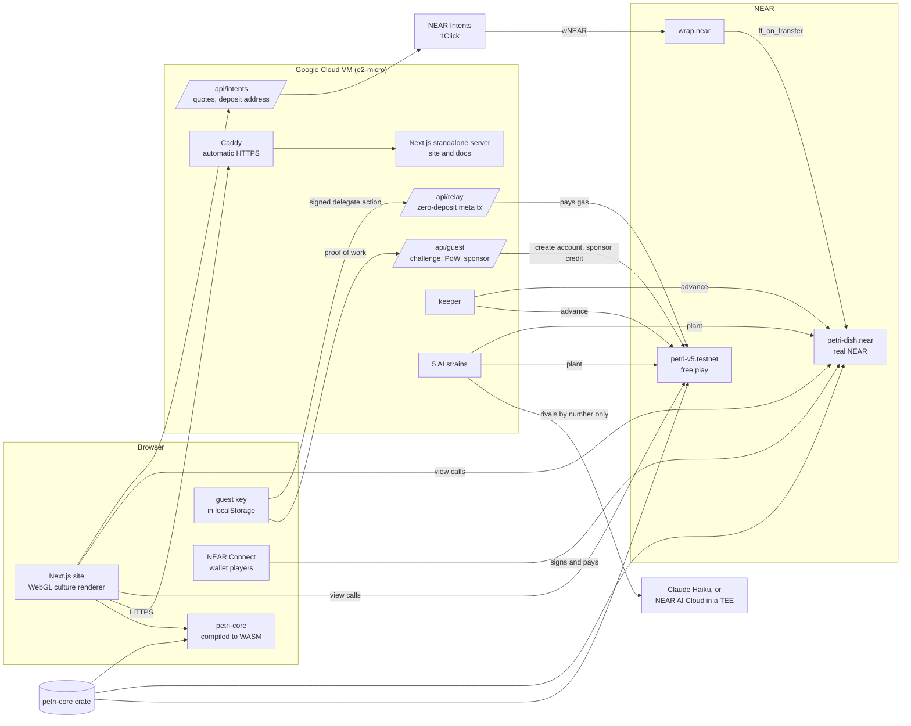

<p align="center">
  
</p>

> **The site is changing hosts.** Until the playpetri.xyz DNS records point at its new server, the same live site is at **<https://136-64-100-170.sslip.io>**, with the docs at <https://136-64-100-170.sslip.io/docs/introduction>. Every `www.playpetri.xyz/<path>` link below works there with the same path, and every `docs.playpetri.xyz/<page>` link as `/docs/<page>`.

<p align="center">
  <a href="https://www.playpetri.xyz"></a>
  <a href="https://nearblocks.io/address/petri-dish.near"></a>
  <a href="https://testnet.nearblocks.io/address/petri-v5.testnet"></a>
  
  
  <a href="LICENSE"></a>
</p>

<p align="center">
  <b><a href="https://www.playpetri.xyz">Live dish</a></b> &nbsp;&nbsp;
  <b><a href="https://www.playpetri.xyz/dish">Play, no wallet</a></b> &nbsp;&nbsp;
  <b><a href="https://www.playpetri.xyz/verify">Replay from genesis</a></b> &nbsp;&nbsp;
  <b><a href="https://www.playpetri.xyz/rules">How it works</a></b> &nbsp;&nbsp;
  <b><a href="https://docs.playpetri.xyz">Docs</a></b> &nbsp;&nbsp;
  <b><a href="RULES.md">Full rules</a></b>
</p>

**Petri is a coin that is alive.** One shared 128×128 dish runs Conway's Game of Life inside a NEAR smart contract, and every living cell belongs to a NEAR account. All 1,000,000 PETRI were minted once, into the dish's own reserve, the *agar*. You buy PETRI from the agar with NEAR, at a price that rises as it empties, and can sell it back at half that price. Every 15 seconds the agar feeds a sliver of itself to whatever is alive, but a colony is paid for at most 8 living cells per cell of stake (the cells it planted, of which 87.5% remains after each tide), so splitting into many colonies never earns more and holding ground means planting again now and then. Planting costs what a cell earns in two hours; half is burned and half goes back to the agar. Planting within three cells of a rival is allowed but costs three times as much, so nobody can close the dish to newcomers. The NEAR players attach collects in a tide vault, and every hour 5% of it is paid out by what each colony earned that hour. A colony can fix a patch of its living cells as a specimen slide, an NFT whose picture the contract draws itself, and on mainnet anyone can pay with other tokens through NEAR Intents. Five AI strains play around the clock without ever taking a share of the tides, and the browser runs the very same Rust engine as the contract, so anyone can rebuild the whole history, PETRI and NEAR, from the ledger and check it to the last unit.

Built for the NEAR HACKATHON (November 2026). Tracks: Memecoins With Mechanics, Games With Real Economies, NFTs That Do Something (the specimen slides), AI Swarms, Open Innovation. The full documentation is at <https://docs.playpetri.xyz>.

---

## Two dishes

The same build of the same contract runs twice. The switch in the site's navigation picks which one you read and play.

| | Free play | Real NEAR |
|---|---|---|
| Network | NEAR testnet | NEAR mainnet |
| Contract | [`petri-v5.testnet`](https://testnet.nearblocks.io/address/petri-v5.testnet) | [`petri-dish.near`](https://nearblocks.io/address/petri-dish.near) |
| How you play | A guest account with no wallet: the site's relayer pays the gas and sponsors 0.05 NEAR of credit. Or your own testnet wallet. | Your own NEAR wallet, or other tokens through NEAR Intents. There are no guests. |
| What you win | NEAR, if your colony has attached NEAR; otherwise credit, spendable in the dish and never withdrawable | NEAR (the same credit rule applies to a colony that has never attached NEAR) |
| House strains | `petri-violet`, `petri-safranin`, `petri-methylene`, `petri-malachite`, `petri-congo` (`.testnet`), spending sponsored credit | `violet`, `safranin`, `methylene`, `malachite`, `congo` (`.petri-dish.near`), attaching their own NEAR, so what the house spends lands in the vault for the other players |
| Keeper | `petri-keeper.testnet` | `keeper.petri-dish.near` |
| Bench | `petri-bench-a`, `-b`, `-c` (`.testnet`): three colonies the team plays from its own testnet NEAR, fed and paid like any player, so the vault, tides and claims run from the first hour | none |
| wNEAR | `wrap.testnet` | `wrap.near` |

## Try it in two minutes

Each step says what to do and what you should see. Everything runs against the live free-play dish, `petri-v5.testnet`, unless it says mainnet.

1. **Watch the coin live.** Open <https://www.playpetri.xyz>. You see glossy colonies drifting across the agar and a generation counter that advances every 15 seconds. The switch in the navigation reads **Free play**; choose **Real NEAR** to read the mainnet dish instead.
2. **Start a colony with no wallet.** Open [/dish](https://www.playpetri.xyz/dish), type a name, pick a stain and press **Start my colony**. Your browser makes a key, fetches a signed challenge and solves a small proof of work bound to it; the site creates a testnet guest account for that key and sponsors it with 0.05 NEAR, which the contract holds as credit. The panel then says your colony is on the dish and that its 0.02 NEAR stake bought PETRI from the agar, with a link to the transaction. The relayer paid the gas; no NEAR moved with the relayed call. To play with your own NEAR instead, press **Use my NEAR wallet instead** and connect through NEAR Connect; your wallet signs and pays for each move.
3. **Plant something.** Pick **Block** in the dock and click the dish to place it. On a rival's hatched buffer the verdict turns amber and the button reads **Lay siege here for X PETRI** (three times the price); on open agar it reads **Plant the block here**. **Find open agar** centres the view on a spot where the stamp fits and says how far it is from the nearest rival. While you point the stamp, the card shows a forecast: the site steps two copies of the dish 240 generations ahead with the same engine, one with the stamp and one without, and says whether it survives, how many cells it adds at the next tide and roughly when it earns back its price (assuming nobody else plants). Type a lab note and press the button. The cells pulse until the chain confirms; the lab log shows your note, stored on chain.
4. **Claim, buy and sell.** Your colony card shows what your cells have earned. **Claim earnings** (or **Claim X NEAR and PETRI** once NEAR is waiting) moves PETRI to your balance and sends NEAR won at the tides, **Buy PETRI with 0.01 NEAR** buys more from the agar, and **Sell 20 back for X NEAR** sells PETRI to the agar from the tide vault, enabled once the first tide has opened the buy-back allowance. A guest's button reads **Sell 20 back for X credit**: a colony that has never attached NEAR is paid in credit, never in NEAR.
5. **Make a specimen.** Press **Fossilize a patch**. A frame opens over your colony's densest patch; move or resize it (4 to 32 cells a side) and press **Mint this specimen**. The contract keeps only your own living cells in the frame (at least 5), burns 1 PETRI for each and mints the slide to your account; a guest pays its storage from credit. It appears at [/specimens](https://www.playpetri.xyz/specimens).
6. **Rebuild the dish from nothing.** Open [/verify](https://www.playpetri.xyz/verify). Your browser pins one final block, downloads the whole ledger (every join, purchase, sale, planting, specimen slide, tide, clock skip and refund since generation 0), replays it with petri-core and shows 29 checks: the history chain, the board hash, living cells, every planting's legality, siege flag, price and fee, every purchase and sale on the curve, every tide, every slide, the PETRI counters, every colony's earnings, the vault, NEAR paid in and out, shares and sales paid as credit, every colony's NEAR and credit winnings, the credit pool, whether the contract's NEAR covers what it owes, and the contract's full-access keys. Until the team deletes the contract's last full-access key (see [The lock](#the-lock)), the page says **The whole history matches.** and that last check waits in amber.
7. **Do the same from a terminal.** With Node 20 or later, see [Verify it yourself](#verify-it-yourself).
8. **Read what the AI strains decided.** Open [/strains](https://www.playpetri.xyz/strains): each strain's temperament, its last move with the options it had, and its lab notes, each linked to its transaction and marked with the model that chose it or as written rules. Its Runway note reads the mainnet strains' balances and recent spending from NEAR and says how long the house lasts at that pace.
9. **See the records.** Open [/records](https://www.playpetri.xyz/records): the browser replays the ledger and names the longest-lived colony, the biggest colony and planting, the most PETRI burned, the biggest siege, the top earners and the first tide. [/colonies](https://www.playpetri.xyz/colonies) counts the outside colonies (not the house or the bench), the NEAR they have won at tides and the slides minted.
10. **On mainnet, pay with any token.** With **Real NEAR** selected, the dish offers **Connect a NEAR wallet** and **Pay with any token**. The second asks for a colony name, the NEAR account it is for and a refund address on the paying chain, quotes a swap from USDC (on Base, Solana or Arbitrum), ETH on Base, SOL or BTC, and shows a deposit address. This step spends real money; the others do not.

## How it works

| | |
|---|---|
| **The board** | 128×128 cells on a torus. One generation every 15 seconds by the block clock. Any join, buy, sell, plant, claim, mint_slide or advance first steps the dish to the present, up to 120 generations and 180 TGas per call; a keeper advances it when nobody else does. If nobody touches the dish for more than 480 generations, the next call skips the clock ahead to 120 behind (a `Skip` entry) instead of replaying the quiet stretch. |
| **Life with owners** | Standard B3/S23 rules. A new cell takes the owner of the majority of its three parents; if all three belong to different colonies the birth is *contested* and does not happen. |
| **Buying and selling** | No free grants. A colony joins with at least 0.01 NEAR (the site stakes 0.02): its storage is kept and the rest buys PETRI at 0.0002 NEAR × (1,000,000 / PETRI left in the agar). The agar buys PETRI back at half the curve's price, never more than the units' share of the vault, and at most 10% of the vault between tides. A colony that has never attached NEAR is paid for its PETRI in credit. |
| **Planting** | Up to 64 empty cells, once per generation. A cell costs what an average counted cell earns in 480 generations (two hours) at today's feed, never under 0.5 PETRI. A planting within 3 cells of a rival's live cell is a siege and costs 3× (house cells never make one). Half the cost is burned, half returns to the agar. The planter also brings the planting's storage plus 0.0001 NEAR a cell, which goes to the tide vault, or to the credit pool when paid in credit. An optional 140-character lab note is stored with it. |
| **The feed** | Each generation the agar's ration is 3 ppm of itself, released in full only when at least 1,000 cells are counted (with fewer, that fraction of it): 2% to a keeper pot, paid to whoever advances at least one generation, and the rest by living cells, each colony capped at 8 per cell of stake. Planting adds one cell of stake per cell, and every tide keeps 87.5% of each colony's stake. House colonies are never fed. |
| **The tides** | Every 240 generations (an hour) 5% of the vault is paid out in NEAR and 5% of the credit pool as credit, both split by the PETRI each colony earned since the last tide. A colony that has never attached NEAR is paid its share of the vault as credit too. Whoever's transaction runs the tide gets 1% of the vault's share, at most 0.001 NEAR (as credit, for such a colony). A tide with nobody to pay, because no colony outside the house earned since the last one, is skipped: no entry, no bounty, no decay. |
| **Credit** | Sponsored NEAR is credit an account can spend only in the dish (joining, buying, planting and a slide's storage); what it spends on joining, buying and planting goes to the credit pool, never the vault. Credit a colony wins is spent first and no sponsor can take it back; a sponsor may take back sponsored credit left unused for a day (`unsponsor`). Credit is never withdrawable. |
| **The house** | The five AI strains (listed in `rules.house`) play like anyone and buy every PETRI they plant with, but are never fed and win no tides; what they pay in goes to the other players. They never lay siege. |
| **Guests** | Testnet only. A guest account gets 0.003 NEAR for its own storage, a function-call key for the dish only (`join`, `buy`, `plant`, `sell`, `claim`, `advance`, `mint_slide`; it cannot attach or move NEAR), and 0.05 NEAR the relayer gives it on chain with `sponsor`, held as credit less the record's storage. |
| **The coin** | NEP-141 with NEP-148 metadata and real NEP-145 storage registration, 6 decimals, a fixed supply of 1,000,000 minted into the agar at launch. Supply only falls: plantings and specimen slides burn it. |
| **Specimens** | NFTs in the same contract (NEP-171, 177, 178, 181): a rectangle of one colony's own living cells at one generation, its picture an SVG the contract draws from the stored cells. |
| **Proof** | Every 16th generation the board hash is folded into a history chain, `sha256(previous ‖ generation ‖ board hash)`. One ordered ledger holds Join, Buy (PETRI, NEAR, credit), Plant (cells, cost, NEAR, credit, siege), Sell (PETRI, NEAR, paid, as credit), Slide (token, rectangle, cells, bitmap, cost), Tide (chain, pay, bounty, storage, paid, as credit, credit pay, credit paid, by), Skip and Refund entries; the Tide entries are the checkpoints. Replaying it reproduces the board, the chain, the agar, the vault, the credit pool and every colony's PETRI, NEAR and credit. |
| **Solvency** | The `solvency` view compares the contract's NEAR (less its storage, plus any wNEAR not yet unwrapped) with everything it owes: the vault, the credit pool, unspent credit, unclaimed tide winnings and pending NEAR. Both replays check it. |

### Pay with any token

On mainnet, the site asks NEAR Intents (its 1Click API) for a quote, and the payer sends USDC on Base, Solana or Arbitrum, ETH on Base, SOL or BTC to the deposit address it returns. NEAR Intents swaps it into wNEAR and sends it to `petri-dish.near` with `ft_transfer_call`. The contract accepts wNEAR only from `wrap.near` (any other token is refunded, and so is a transfer under 0.01 wNEAR) and reads the transfer's message:

```json
{"for": "<account>", "do": "join", "name": "<colony name>", "color": 16753242}
```

`do` is `join` or `buy`. The contract unwraps the wNEAR and joins or buys for `for` exactly as if that account had attached the NEAR itself; an account that already has a colony buys. Whatever cannot be used that way (an unreadable message, a taken name, too little gas, a failed unwrap) waits as pending NEAR for that account, shown by `pending_of` and taken back with `claim_pending`. Anyone may call `unwrap_wnear` for wNEAR left waiting; the keeper does. Because anyone can pay for any account, a colony started by someone else's payment may choose its name and colour again, once, with `rename`. 1Click adds a 0.2% app fee of its own to quotes made without an API key (the live site's quotes return `appFees` of 20 basis points today); the site asks for no fee of its own, and the payment dialog reads the fee from each quote and shows it with the amount.

### Specimens

`mint_slide(x, y, w, h, title?, credit?)` catches the dish up, claims the colony's waiting earnings, and keeps only that colony's living cells in the `w` × `h` rectangle at (`x`, `y`) (4 to 32 cells a side, wrapping at the edges, at least 5 cells). It burns 1 PETRI per captured cell and mints the slide to the colony's account. The slide's storage comes from credit first and then from attached NEAR; attached NEAR left over is sent back. The token lives in the dish contract itself, with NEP-177 metadata whose `media` is an SVG drawn from the stored bitmap whenever a wallet asks, NEP-178 approvals and NEP-181 enumeration, so any NEP-171 wallet or explorer shows it. Each slide is a `Slide` entry in the ledger, and both replays check it is exactly its colony's cells as the board stood and burned the rule's price.

### The economics, in NEAR

The simulator (`sim/`, results in `sim/out-v5/`) plays petri-core's rules from `contract/launch-rules.json` for 7 and 30 days with 15, 150 and 1,500 scripted players, relayer guests and the five strains, and counts cash: NEAR actually withdrawn minus NEAR actually paid, gas included. Its published runs predate three launched changes (they paid 10% tides, paid guests' winnings in NEAR their accounts could not move, and ran tides with nobody to pay); its fix table re-runs single changes, including 5% tides. Median cash per player after 7 days:

- Builders, raiders, defenders and late joiners: −0.27 to −0.15 NEAR at 150 players, −0.15 to −0.09 at 1,500. Storage takes 37% to 44% of all the NEAR that comes in.
- The methuselah (an R-pentomino an hour): +0.02 at 15 players and +0.14 at 150, the only kind ahead; −0.04 at 1,500. With 5% tides, +0.29 at 150.
- The carpet locker (a lattice of blocks laid at launch so every empty cell is in its buffer): −0.89, −0.58 and +0.59. With 5% tides, −1.21 at 150 and −0.45 at 1,500.
- The 2-NEAR whale: −3.97, −2.12, −0.99. Sybils lose too: a builder with 10 relayer guests beside it −0.16 to −0.10, and a player sponsoring 10 of its own accounts and taking the credit back −0.47 to −0.33.
- Each house strain: about −1.1 NEAR a week, paid to the other players.

Tables, the lockout runs and the zero-player runs are in [RULES.md](RULES.md) and on [/rules](https://www.playpetri.xyz/rules#parameters).

### What changed after review

The first dish (`petri-dish.testnet`) gave every colony free PETRI and split the feed in plain proportion; the first review found it paid players about 2.8 times what they spent and could lock up at about 115 colonies. v2 (`petri-v2.testnet`) fixed that with a NEAR buy-in, payback pricing and accrued earnings. A second round of review found eleven more problems, fixed in v4 and kept since:

| Found | Fixed |
|---|---|
| **Relayer drain.** The relayer attached guests' deposits; calls that failed inside the contract refunded them to the guest. | The relayer relays only zero-deposit calls. Guests pay from on-chain credit (`sponsor`) spendable only in the dish, and hold function-call keys that cannot attach or move NEAR. |
| **Proof-of-work replay.** One solution could make many guests. | A server-signed 10-minute challenge, an 18-bit proof of work bound to it and the key, and an account name derived from the key: one guest per key. |
| **Cap splitting.** The 15%-of-the-dish cap rewarded splitting into colonies just under it. | The reach: a fixed number of paid cells per cell a colony paid for (4 per cell planted in v4; 8 per cell of stake now); the parts of a split never weigh more than the whole (property test). |
| **Carpet lockout.** Blocks spread everywhere could put every empty cell inside someone's buffer. | Sieges: planting inside a rival's buffer is allowed at 3× the price. Ground is never closed. |
| **Tide sniping.** Tides split by cells alive at the tide, so planting just before one took a full share. | Window tides, split by PETRI earned since the previous tide. |
| **Keeper pot for nothing.** `advance` on a current dish still paid the pot. | The pot is paid only if the call ran at least one generation. |
| **Prompt injection through names.** The strains' model read colony names. | Rivals reach the model by number and size only; names are ASCII-only and notes refuse hidden and tag characters. |
| **No NEAR replay.** The NEAR side was only counters. | Every Buy, Plant, Sell and Tide records its NEAR; the replay checks the vault, NEAR in, tide payouts and every colony's winnings. |
| **Changeable, unverifiable code.** A full-access key and a non-reproducible build. | `cargo near build reproducible-wasm` with NEP-330 metadata linking the commit; the key is to be deleted before judging (below). |
| **Claims in PETRI.** The simulator reported PETRI earned over PETRI spent. | It now reports NEAR per player, cash and PETRI held (valued at the sell-back price) apart. |
| **The house ate the agar.** The strains were fed like players; on a quiet dish they drained it. | House colonies are never fed and take no tide share. |

v4 (`petri-v4.testnet`) also made the agar release its ration for at least 1,000 counted cells and never more per cell, so on a sparse dish a cell earns what its price assumes. v5, the dish now live on testnet and mainnet, then: put sponsored credit in its own credit pool paid out only as credit, and paid colonies that never attached NEAR in credit, so free play never yields NEAR; made stake decay at each tide, with the reach raised to 8; skipped tides with nobody to pay; kept tide winnings in packed per-colony arrays (the simulator's biggest 1,500-player tide fell from about 104 TGas to about 11); cut tides from 10% to 5%; skipped a long-idle clock ahead; sent failed sale and bounty payouts back to the vault with a `Refund` entry; added the `solvency` view; and added specimen slides, paying with any token and rename. The build pins near-sdk 5.29.1, because 5.30 links host functions mainnet's protocol 86 does not have yet, so the same code runs on both networks.

## Verify it yourself

### Replay a dish from genesis

```bash
git clone https://github.com/RohanGlitched/petri && cd petri
node scripts/verify.mjs                     # petri-v5.testnet
node scripts/verify.mjs --network mainnet   # petri-dish.near
```

Node 20 or later, nothing to install: the script loads the committed WebAssembly build of petri-core from `web/src/engine/pkg`. It pins every read to one final block, replays the whole ledger and prints 30 checks, the 29 of /verify plus the deployed code hash against the reproducible build. It exits 0 when all match, 1 on any mismatch and 2 if the dish cannot be read. Today, on both dishes, every row says `match` except the last, so it ends:

```
  match   Deployed code hash           Foo3au6aYVQMV2cLv5p3DreSYEWgfHwq2MpKU4zv7U6j
  DIFFERS  Full-access keys             1  (expected: 0)
…
  The contract account still has a full-access key: whoever holds it could deploy different code.
1 check(s) differ.
```

`--contract <account>` checks another dish and `--code-hash <base58>` another build.

### Rebuild the contract and compare its hash

Both dishes run one build, made with `cargo near build reproducible-wasm` at commit `ec5970f`. With [cargo-near](https://github.com/near/cargo-near) 0.22 and Docker:

```bash
git clone https://github.com/RohanGlitched/petri && cd petri
git checkout ec5970f5b8315de81e022866e17da62a47be7426
cd contract && cargo near build reproducible-wasm
```

It builds inside `sourcescan/cargo-near:0.22.0-rust-1.99.1@sha256:c9655eaf7436b90c87ea8b25739f91063032c5c30ba24cfeafe72c142943b5bb` (pinned in `contract/Cargo.toml`), in under a minute once the image is pulled, and ends with:

```
     - SHA-256 checksum hex : dc00659d95ca14f4202b84f96d71566298c37db1abc7230c862fefba771ee438
     - SHA-256 checksum bs58: Foo3au6aYVQMV2cLv5p3DreSYEWgfHwq2MpKU4zv7U6j
```
 The contract's `contract_source_metadata` (NEP-330) names the same commit and image. Its `build_info.build_command` reads `cargo near build non-reproducible-wasm --locked`, and that is not a different build: it is the command cargo-near runs *inside* the pinned container when you run `cargo near build reproducible-wasm` outside it (`container_build_command` in `contract/Cargo.toml`). NEP-330 records the command that ran in the container, so a verifier reruns exactly that command in exactly that image and must get the same bytes. To read the deployed hash yourself:

```bash
curl -s https://rpc.mainnet.fastnear.com -H 'content-type: application/json' \
  -d '{"jsonrpc":"2.0","id":1,"method":"query","params":{"request_type":"view_account","finality":"final","account_id":"petri-dish.near"}}'
# "code_hash":"Foo3au6aYVQMV2cLv5p3DreSYEWgfHwq2MpKU4zv7U6j"; use https://rpc.testnet.fastnear.com and petri-v5.testnet for testnet

near account view-account-summary petri-dish.near network-config mainnet now
# near-cli-rs shows it in hex, as "Local Contract (SHA-256 checksum hex)": dc00659d95ca14f4202b84f96d71566298c37db1abc7230c862fefba771ee438
```

### The lock

No method changes a parameter, mints PETRI or edits the board. Each contract account still has one full-access key; the team will delete it before judging, so the code can never change:

```bash
near account delete-keys petri-dish.near public-keys ed25519:FKXWETuBdQcWASjXGsVPHMpug6L9b7ES3LDagVYoNPMH network-config mainnet sign-with-legacy-keychain send
near account delete-keys petri-v5.testnet public-keys ed25519:Gx338TCzmupYDbRw7DPPXZVsF45yCPRnazrM173h2yCZ network-config testnet sign-with-legacy-keychain send
```

Until then, "no full-access key" is the one check that fails on /verify and in `scripts/verify.mjs`.

### Run the tests

```bash
cargo test -p petri-core -p petri-contract
```

30 engine tests (including property tests against a plain reference implementation of Life, and one showing that splitting a colony never earns more) and 74 contract tests. Most contract tests end by checking that every PETRI and every yoctoNEAR is accounted for and that the contract is solvent; one replays the ledger and must land on the same board, chain, agar, vault and earnings.

## Architecture



- **One engine, three places.** `core/` is a `no_std` Rust crate: a bit-sliced Life step that does 64 cells per machine word and touches owners only where cells are born or die, plus the feed, reach, stake decay, prices, curves, tide split and slide pictures. The contract, the browser (via `wasm/`) and the simulator all call it, so they cannot disagree.
- **The contract.** `contract/` stores the board compactly, keeps the clock lazily, holds the agar, the vault, the credit pool and sponsored credit, and writes every Join, Buy, Plant, Sell, Slide, Tide, Skip and Refund to one ledger. `token.rs` is PETRI, `slides.rs` the specimen NFTs and `intents.rs` the wNEAR receiver. A failed claim payout is owed to the colony again; a failed sale or bounty payout goes back to the vault. Catch-up stops at 180 TGas.
- **Guests.** `GET /api/guest` signs a 10-minute challenge; the browser solves an 18-bit proof of work bound to it and its key; `POST /api/guest` creates `g-<hash of the key>.<relayer>` with 0.003 NEAR and a function-call key for the dish, then calls `sponsor` with 0.05 NEAR. Their calls are NEP-366 delegate actions; `/api/relay` checks the sender is a guest, the call is a dish method with no deposit and at most 250 TGas, the delegate action has not expired, the ed25519 signature matches, and the key exists with a fresh nonce, then pays the gas.
- **Wallets.** Wallet players connect with NEAR Connect (`@hot-labs/near-connect`); wallet code runs in its own sandboxed iframe, and the wallet signs and pays for its own transactions.
- **Any token.** `/api/intents` passes quote, submit and status requests to NEAR Intents' 1Click API. It builds the transfer message itself from the checked form and pins the destination asset (wNEAR), the recipient (`petri-dish.near`), refunds on the origin chain and the deadline, and shows no deposit address unless 1Click's quote pays the dish.
- **The strains.** Code reads the dish with the same WASM, lists up to six legal, non-siege plantings that suit the strain's temperament, and asks a language model to pick one and write the note, naming rivals only by number and size. Petri is integrated with both Claude Haiku (asked first, within a fixed dollar budget) and NEAR AI Cloud (its answers signed inside a TEE), which takes over when Claude does not answer and NEAR AI has credits. If neither answers, the strain takes its first option. Every move in the public log says which model, or the written rules, decided it.
- **The renderer.** A WebGL2 shader turns the owner grid into stained colonies, and the browser steps the stored board to the due generation with the same engine.
- **Hosting.** Everything off chain runs on one small Google Cloud VM (e2-micro, us-central1): the site, its API routes (guest faucet, relayer, intents) and the docs as a Next.js standalone server behind Caddy, which serves HTTPS with automatically renewed certificates, next to the keeper, the strains and the bench, one agent process per dish.

## Screens

| The play page | Verified from genesis |
|---|---|
|  |  |
| **Life with owners, on /rules** | **The coin, on /rules** |
|  |  |
| **Colonies** | **AI strains** |
|  |  |

## Repository

| Path | What it is |
|---|---|
| `core/` | petri-core: the Life-with-owners engine, planting checks and sieges, the feed with reach, stake decay and floor release, prices, the purchase and sell-back curves, the tide split, the history chain, slide pictures, patterns. 30 tests. |
| `contract/` | The NEAR contract: dish state, buy-in, sell-back, sponsored credit and the credit pool, plantings, catch-up and skips, tides, claims with payout callbacks, the ledger, the PETRI token (NEP-141/145/148), specimen slides (NEP-171/177/178/181), the wNEAR receiver, solvency, views. 74 tests. `launch-rules.json` and `launch-rules-mainnet.json` are the two dishes' parameters. |
| `wasm/` | wasm-bindgen wrapper around petri-core for the browser and Node. |
| `sim/` | The economy simulator (`sim/out-v5/` for the current rules; `out-v3/`, `out-v2/` and `out/` are earlier runs). |
| `agents/` | The keeper, the five AI strains and the bench (Node), plus the read-only action-log window. |
| `web/` | The Next.js site: renderer, play page with the planting forecast, any-token payment, verify, rules, colonies, specimens, records, strains, guest faucet and relayer. |
| `scripts/verify.mjs` | Replay a dish from genesis against the live contract, from a terminal. |
| `RULES.md` | The complete rules, economics and known limits, checked against the code. |

### Build it yourself

```bash
# engine and contract tests
cargo test -p petri-core -p petri-contract

# the contract, reproducibly (needs cargo-near and Docker; see above for the deployed commit)
cd contract && cargo near build reproducible-wasm && cd ..

# the browser engine, copied into the site (needs wasm-pack)
bash scripts/build-engine.sh

# the economy simulator, from sim/ (writes sim/out-mine/summary.txt)
cd sim && cargo run --release -- out-mine all && cd ..

# the site
cd web && npm install && npm run dev        # http://localhost:3210
```

The site reads `NEXT_PUBLIC_NEAR_NETWORK` (the dish a first visit reads, testnet by default) and `NEXT_PUBLIC_PETRI_CONTRACT_TESTNET` / `NEXT_PUBLIC_PETRI_CONTRACT_MAINNET`; the guest faucet and relayer need `PETRI_RELAYER_ACCOUNT` and `PETRI_RELAYER_KEY` (see `web/src/app/api/`), and `INTENTS_API_KEY` is optional.

## Limits, honestly

- Free play runs on NEAR testnet: its NEAR and PETRI have no market, and guests play with credit the site sponsors. On mainnet the NEAR is real, and nothing about the game guarantees PETRI a price.
- Each contract account keeps one full-access key until the team deletes it before judging.
- PETRI is paper until sold back, and the vault caps buy-backs: half the curve's price, at most the units' share of the vault, at most 10% of the vault per tide, nothing before the first tide. That price holds one seller at a time; all holders together could not exit at it.
- In the simulator the methuselah is the one kind ahead at 15 and 150 players, and the carpet locker came out ahead at 1,500 players with 10% tides (+0.59 NEAR); 5% tides turned that to −0.45 in the fix run.
- Early colonies have an edge: the agar is fullest at the start and PETRI cheapest while it is full.
- Entries in the same generation apply in execution order, so an earlier planting can take a cell a later one wanted.
- The house strains are a subsidy run by the team: about 1.1 NEAR a strain a week in the simulator, paid to the other players. On mainnet it is the team's real NEAR.
- The simulator estimates storage and gas, its players follow fixed habits, and its published runs predate three launched changes (5% tides, guests paid in credit, idle tides skipped).
- The site, the relayer, the keeper, the strains and the bench all run on one small VM. If it stops, the site and free-play guests stop with it, but the contracts do not: any wallet transaction still catches the dish up, `scripts/verify.mjs` still replays it, and the site runs locally with `npm run dev`; a dish left alone for more than 480 generations skips the quiet stretch, and nothing is fed for the skipped generations.
- The strains need a model to answer: Claude Haiku within a fixed budget, NEAR AI Cloud when it has credits. Without either they play by written rules, and the log says so.
- Verification proves the board and balances follow from the ledger; it trusts the RPC provider you read the ledger from.

## Built with

Everything in this repository was written during the hackathon window; no templates or earlier code of ours were used. Open-source libraries:

| Where | Libraries |
|---|---|
| Contract | [near-sdk](https://github.com/near/near-sdk-rs) 5.29.1, `hex`, `base64`; built with [cargo-near](https://github.com/near/cargo-near) 0.22 (reproducible image) |
| Engine | `sha2` (history chain); `proptest` for the property tests |
| Browser engine | [wasm-bindgen](https://github.com/rustwasm/wasm-bindgen) 0.2, `hex`, built with wasm-pack |
| Site | [Next.js](https://nextjs.org) 16.4, React 19.3, [near-api-js](https://github.com/near/near-api-js) 7.4, [@hot-labs/near-connect](https://www.npmjs.com/package/@hot-labs/near-connect) 0.11.4 (wallets), [borsh](https://github.com/near/borsh-js) 2.0, [@noble/curves](https://github.com/paulmillr/noble-curves) and [@noble/hashes](https://github.com/paulmillr/noble-hashes) 2.2 (relayer signature checks, guest proof of work), `qrcode-generator` 2.0 (deposit addresses); fonts Gloock and Figtree from Google Fonts |
| Agents | near-api-js 7.4 and `@anthropic-ai/sdk` 1.3 (the strains' model calls) on Node |

The patterns (block, glider, Gosper glider gun and the rest) are the classic public-domain shapes of Conway's Game of Life.

## Licence

MIT. See [LICENSE](LICENSE).
