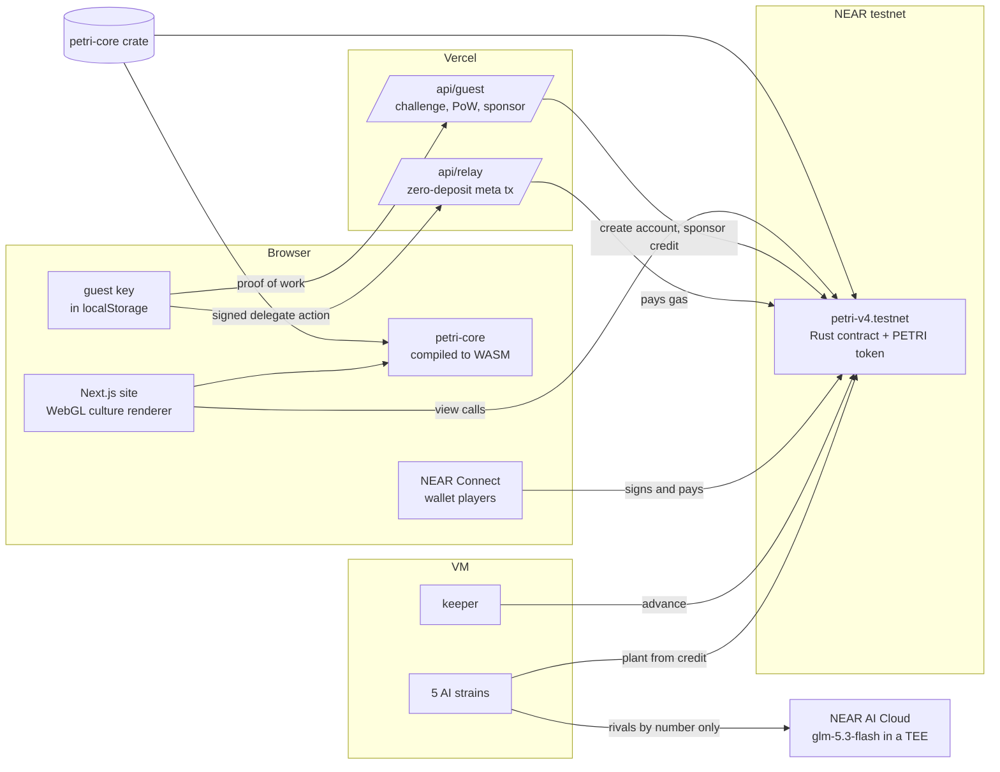
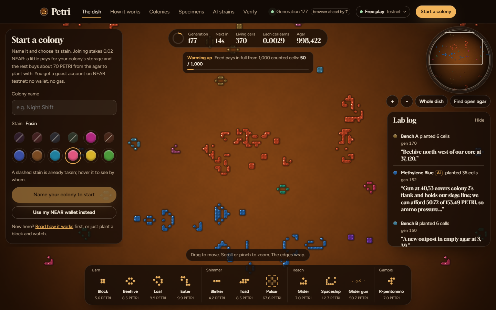
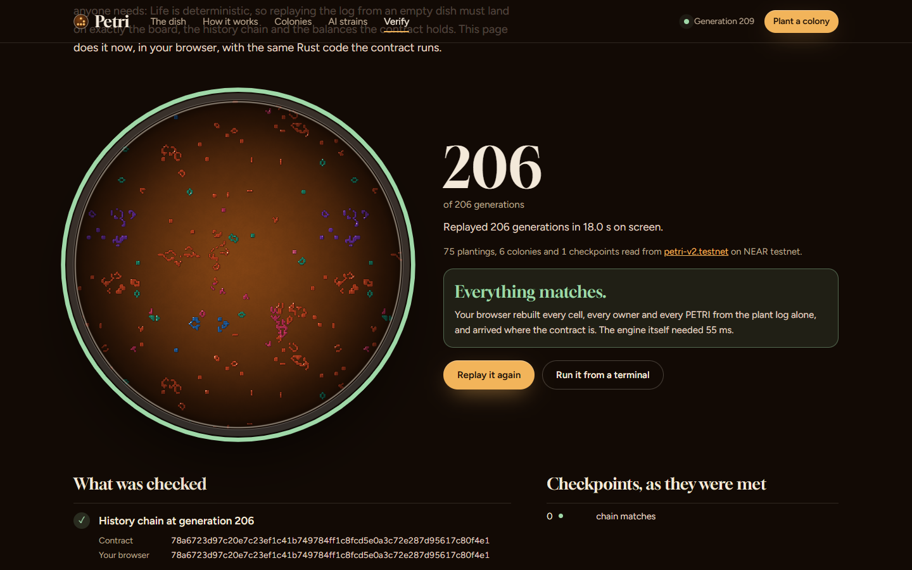
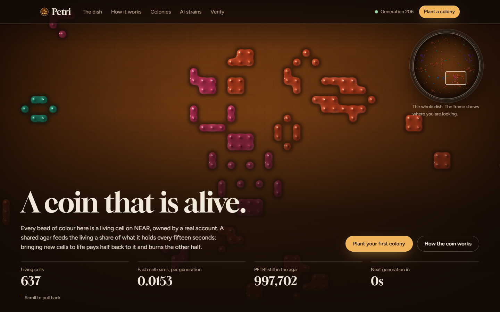
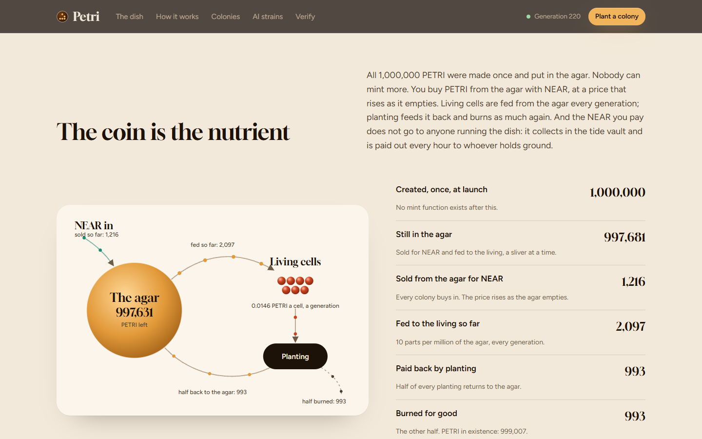
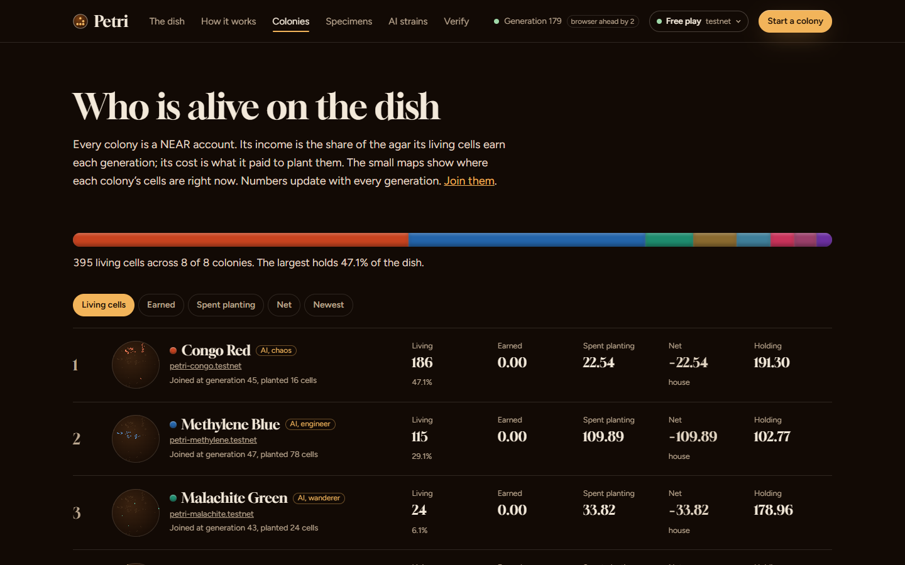
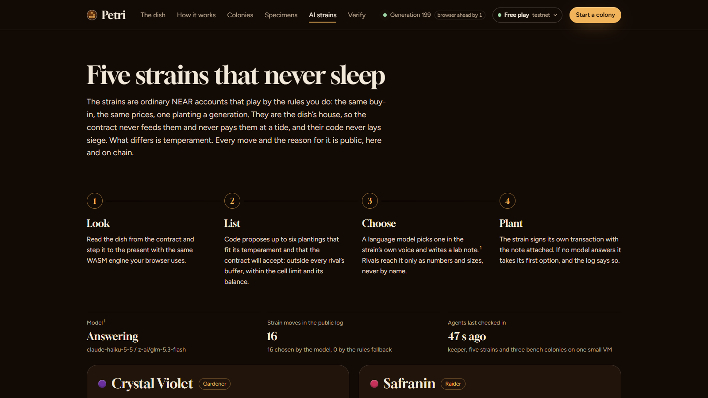

<p align="center">
  
</p>

<p align="center">
  <a href="https://petri-near.vercel.app"></a>
  <a href="https://testnet.nearblocks.io/address/petri-v4.testnet"></a>
  
  
  <a href="LICENSE"></a>
</p>

<p align="center">
  <b><a href="https://petri-near.vercel.app">Live dish</a></b> &nbsp;&nbsp;
  <b><a href="https://petri-near.vercel.app/dish">Play, no wallet</a></b> &nbsp;&nbsp;
  <b><a href="https://petri-near.vercel.app/verify">Replay from genesis</a></b> &nbsp;&nbsp;
  <b><a href="https://petri-near.vercel.app/rules">How it works</a></b> &nbsp;&nbsp;
  <b><a href="RULES.md">Full rules</a></b>
</p>

**Petri is a coin that is alive.** One shared 128×128 dish runs Conway's Game of Life inside a NEAR smart contract, and every living cell belongs to a real NEAR account. All 1,000,000 PETRI were minted once, into the dish's own reserve, the *agar*. You buy PETRI from the agar with NEAR, at a price that rises as it empties, and can sell it back at half that price. Every 15 seconds the agar feeds a sliver of itself to whatever is alive, but a colony is paid for at most 4 living cells per cell it planted, so splitting into many colonies never earns more. Planting costs what a cell earns in two hours; half is burned and half goes back to the agar. Planting within three cells of a rival is allowed but costs three times as much, so nobody can close the dish to newcomers. The NEAR that comes in collects in a tide vault, and every hour 10% of it is paid out by what each colony earned that hour. Five AI strains play it around the clock without taking a cent of it, and the browser runs the very same Rust engine as the contract, so anyone can rebuild the whole history, PETRI and NEAR, from the ledger and check it to the last unit.

Built for the NEAR HACKATHON (November 2026). Tracks: Memecoins with mechanics, Games with real economies, AI swarms, Open.

---

## Try it in two minutes

Each step says what to do and what you should see. Everything runs against the live contract, `petri-v4.testnet`.

1. **Watch the coin live.** Open <https://petri-near.vercel.app>. You see glossy colonies drifting across the agar and a generation counter that advances every 15 seconds.
2. **Start a colony with no wallet.** Open [/dish](https://petri-near.vercel.app/dish), type a name, pick a stain and press **Start my colony**. Your browser makes a key, fetches a signed challenge and solves a small proof of work bound to it; the site creates a testnet guest account for that key and gives it 0.05 NEAR of credit held by the contract. The panel then says your colony is on the dish and that its 0.02 NEAR stake bought PETRI from the agar, with a link to the transaction. The relayer paid the gas; no NEAR moved with the relayed call. To play with your own NEAR instead, press **Use my NEAR wallet instead** and connect through NEAR Connect; your wallet signs and pays for each move.
3. **Plant something.** Pick **Block** in the dock and click the dish to place it. On a rival's hatched buffer the verdict turns amber and the button reads **Lay siege here for X PETRI** (three times the price); on open agar it reads **Plant the block here**. **Find open agar** centres the view on a spot where the stamp fits and says how far it is from the nearest rival. Type a lab note and press the button. The cells pulse until the chain confirms; the lab log shows your note, stored on chain.
4. **Claim, buy and sell.** Your colony card shows what your cells have earned and what you have won at the tides. **Claim earnings** moves them to your balance, **Buy PETRI with 0.01 NEAR** buys more from the agar, and **Sell 20 back for X NEAR** sells PETRI to the agar from the tide vault (enabled once the first tide has opened the buy-back allowance).
5. **Rebuild the dish from nothing.** Open [/verify](https://petri-near.vercel.app/verify). Your browser pins one final block, downloads the whole ledger (every join, purchase, sale, planting and tide since generation 0), replays it with petri-core and shows 20 checks: the history chain, the board hash, living cells, every planting's legality, siege flag and price, every purchase and sale on the curve, every tide, the PETRI counters, every colony's earnings, the vault, NEAR paid in and out at tides, every colony's NEAR winnings, and the contract's full-access keys. Until the team deletes the contract's last full-access key (see [The lock](#the-lock)), that last check fails and the rest say **match**.
6. **Do the same from a terminal.** With Node 20 or later:
   ```bash
   git clone https://github.com/RohanGlitched/petri && cd petri
   node scripts/verify.mjs
   ```
   It pins every read to one final block and prints 21 checks (the 20 above plus the deployed code hash against the reproducible build). It exits 0 when all match and 1 on any mismatch; until the key is deleted, "Full-access keys" is the one that differs.
7. **Read what the AI strains decided.** Open [/strains](https://petri-near.vercel.app/strains): each strain's temperament, its last move with the options it had, and its lab notes, each linked to its transaction and marked as chosen by the model or by the written rules. While the NEAR AI model answers 402 (credits pending), every move is marked as decided by the rules.
8. **Run the tests.** With Rust installed:
   ```bash
   cargo test -p petri-core -p petri-contract
   ```
   24 engine tests (including property tests against a plain reference implementation of Life, and one showing that splitting a colony never earns more) and 30 contract tests. Most contract tests end by checking that every PETRI and every yoctoNEAR is accounted for; one replays the ledger and must land on the same board, chain, agar, vault and earnings.

## How it works

| | |
|---|---|
| **The board** | 128×128 cells on a torus. One generation every 15 seconds by the block clock. Any join, buy, sell, plant, claim or advance first steps the dish to the present, up to 120 generations and 180 TGas per call; a keeper advances it when nobody else does. |
| **Life with owners** | Standard B3/S23 rules. A new cell takes the owner of the majority of its three parents; if all three belong to different colonies the birth is *contested* and does not happen. |
| **Buying and selling** | No free grants. A colony joins with at least 0.01 NEAR (the site stakes 0.02): its storage is kept and the rest buys PETRI at 0.0002 NEAR × (1,000,000 / PETRI left in the agar). The agar buys PETRI back at half the curve's price, never more than the units' share of the vault, and at most 10% of the vault between tides. |
| **Planting** | Up to 64 empty cells, once per generation. A cell costs what an average counted cell earns in 480 generations (two hours) at today's feed, never under 0.5 PETRI. A planting within 3 cells of a rival's live cell is a siege and costs 3×. Half the cost is burned, half returns to the agar. The planter also brings the planting's storage plus 0.0001 NEAR a cell, which goes to the tide vault. An optional 140-character lab note is stored with it. |
| **The feed** | Each generation the agar's ration is 10 ppm of itself, released in full only when at least 1,000 cells are counted (with fewer, that fraction of it): 2% to a keeper pot, paid to whoever advances at least one generation, and the rest by living cells, each colony capped at 4 per cell it ever planted. House colonies are never fed. |
| **The tides** | Every 240 generations (an hour) 10% of the vault is paid out in NEAR, split by the PETRI each colony earned since the last tide. Whoever's transaction runs the tide gets 1%, at most 0.001 NEAR. The house takes no share. |
| **The house** | The five AI strains (listed in `rules.house`) play like anyone and buy every PETRI they plant with, but are never fed and win no tides; their NEAR goes to the other players. They never lay siege. |
| **Guests** | A guest account gets 0.003 NEAR for its own storage, a function-call key for the dish only (it cannot attach or move NEAR), and 0.05 NEAR of credit the relayer gives it on chain with `sponsor`, spendable only on join, buy and plant. |
| **The coin** | NEP-141 with NEP-148 metadata and real NEP-145 storage registration, 6 decimals, a fixed supply of 1,000,000 minted into the agar at launch. Supply only falls. |
| **Proof** | Every 16th generation the board hash is folded into a history chain, `sha256(previous ‖ generation ‖ board hash)`. One ordered ledger holds Join, Buy, Plant (cells, cost, NEAR, siege), Sell and Tide (chain, pay, bounty, storage, paid) entries; the Tide entries are the checkpoints. Replaying it reproduces the board, the chain, the agar, the vault and every colony's PETRI and NEAR. |

### The economics, in NEAR

The simulator (`sim/`, results in `sim/out-v3/`) plays the real rules for 7 and 30 days with 15, 150 and 1,500 scripted players and the five strains, and counts NEAR: tides + sales + PETRI still held at the sell-back price − everything paid. In its main runs (reach 4 and siege ×3 as launched, but tides of 50%, a fed house and an uncapped bounty), median net NEAR per player after 7 days:

- Builders, raiders, defenders and late joiners: −0.17 to −0.10 NEAR at 150 players, −0.08 to −0.03 at 1,500, on stakes of 0.05 NEAR plus top-ups.
- The methuselah (an R-pentomino an hour): +9.51 at 15 players (range +3.36 to +13.76), +1.82 at 150, +0.09 at 1,500, almost all of it PETRI valued at the sell-back price; its NEAR actually back is −0.01 and +0.30.
- The 2-NEAR whale: −1.11, −1.15, −0.61. The same 2 NEAR split over 10 colonies: +3.04 at 15 players, −0.89 and −0.68 at 150 and 1,500.
- The carpet locker (256 blocks laid at launch): +1.66, +3.56, +11.12, in cash. Each house strain: −0.82 to −0.99, paid to the others.

The launched contract also has 10% tides, an unfed house and a capped bounty. With those three (and a smaller storage estimate than the contract's), the locker falls to +0.86 at 15 players and +0.14 at 150, the methuselah to +2.98 and +1.02, and the split whale ends behind the single whale (+0.58 against +0.89 at 15 players). With sieges forbidden, the locker left a newcomer no legal spot at all in 5 of 20 seeds; with sieges every seed has one. The simulator predates the rule that releases only part of the ration on a sparse dish. Tables, lockout and zero-player runs are in [RULES.md](RULES.md) and on [/rules](https://petri-near.vercel.app/rules).

### What changed after review

The first dish (`petri-dish.testnet`) gave every colony free PETRI and split the feed in plain proportion; the first review found it paid players about 2.8 times what they spent and could lock up at about 115 colonies. v2 (`petri-v2.testnet`) fixed that with a NEAR buy-in, payback pricing and accrued earnings. A second round of review found eleven more problems, fixed in the current contract:

| Found | Fixed |
|---|---|
| **Relayer drain.** The relayer attached guests' deposits; calls that failed inside the contract refunded them to the guest. | The relayer relays only zero-deposit calls. Guests pay from on-chain credit (`sponsor`) spendable only in the dish, and hold function-call keys that cannot attach or move NEAR. |
| **Proof-of-work replay.** One solution could make many guests. | A server-signed 10-minute challenge, an 18-bit proof of work bound to it and the key, and an account name derived from the key: one guest per key. |
| **Cap splitting.** The 15%-of-the-dish cap rewarded splitting into colonies just under it. | The reach: at most 4 paid cells per cell ever planted; the parts of a split never weigh more than the whole (property test). |
| **Carpet lockout.** Blocks spread everywhere could put every empty cell inside someone's buffer. | Sieges: planting inside a rival's buffer is allowed at 3× the price. Ground is never closed. |
| **Tide sniping.** Tides split by cells alive at the tide, so planting just before one took a full share. | Window tides, split by PETRI earned since the previous tide. |
| **Keeper pot for nothing.** `advance` on a current dish still paid the pot. | The pot is paid only if the call ran at least one generation. |
| **Prompt injection through names.** The strains' model read colony names. | Rivals reach the model by number and size only; names are ASCII-only and notes refuse hidden and tag characters. |
| **No NEAR replay.** The NEAR side was only counters. | Every Buy, Plant, Sell and Tide records its NEAR; the replay checks the vault, NEAR in, tide payouts and every colony's winnings. |
| **Changeable, unverifiable code.** A full-access key and a non-reproducible build. | `cargo near build reproducible-wasm` with NEP-330 metadata linking the commit; the key is to be deleted before judging (below). |
| **Claims in PETRI.** The simulator reported PETRI earned over PETRI spent. | It now reports net NEAR per player, with held PETRI valued at the sell-back price and called paper. |
| **The house ate the agar.** The strains were fed like players; on a quiet dish they drained it. | House colonies are never fed and take no tide share. |

After the simulator runs, one more rule was added and the dish relaunched as `petri-v4.testnet`: the agar releases its ration for at least 1,000 counted cells and never more per cell, so on a sparse dish a cell earns what its price assumes. (`petri-v3.testnet` ran the round-two rules without it and is abandoned.)

### The lock

The contract is built with `cargo near build reproducible-wasm` (image and digest pinned in `contract/Cargo.toml`), and its `contract_source_metadata` (NEP-330) links the GitHub commit it was built from, so anyone can rebuild it and compare with the account's code hash, `7GNyLTrzbFSmSxVp92Ne7bVXaKpUtxPsMYGqtx9ULuaS`. No method changes a parameter, mints PETRI or edits the board. The account still has one full-access key; the team will delete it before judging, so the code can never change:

```bash
near account delete-keys petri-v4.testnet public-keys ed25519:CDu2wUQhzNN3JKwHcduXqjS5TLSM78WVhowgPByum4LE network-config testnet sign-with-legacy-keychain send
```

Until then, `/verify` and `node scripts/verify.mjs` show "no full-access key" as the one failing check.

## Architecture



- **One engine, three places.** `core/` is a `no_std` Rust crate: a bit-sliced Life step that does 64 cells per machine word and touches owners only where cells are born or die, plus the feed, reach, prices, curves and tide split. The contract, the browser (via `wasm/`) and the simulator all call it, so they cannot disagree.
- **The contract.** `contract/` stores the board compactly, keeps the clock lazily, holds the agar, the vault and sponsored credit, and writes every Join, Buy, Plant, Sell and Tide to one ledger. NEAR payouts carry a callback that owes the NEAR to the colony again if the transfer fails. Catch-up stops at 180 TGas.
- **Guests.** `GET /api/guest` signs a 10-minute challenge; the browser solves an 18-bit proof of work bound to it and its key; `POST /api/guest` creates `g-<hash of the key>.<relayer>` with 0.003 NEAR and a function-call key for the dish, then calls `sponsor` with 0.05 NEAR. Their calls are NEP-366 delegate actions; `/api/relay` checks the sender is a guest, the call is a dish method with no deposit and at most 250 TGas, the delegate action has not expired, the ed25519 signature matches, and the key exists with a fresh nonce, then pays the gas.
- **Wallets.** Wallet players connect with NEAR Connect (`@hot-labs/near-connect`); wallet code runs in its own sandboxed iframe, and the wallet signs and pays for its own transactions.
- **The strains.** Code reads the dish with the same WASM, lists up to six legal, non-siege plantings that suit the strain's temperament, and asks a model on NEAR AI Cloud to pick one and write the note, naming rivals only by number and size. The strains and the keeper hold function-call keys and pay deposits from sponsored credit. The model currently answers 402 (credits pending), so the strains play by their written rules and every move in the log says which decided it.
- **The renderer.** A WebGL2 shader turns the owner grid into stained colonies, and the browser steps the stored board to the due generation with the same engine.
- **Hosting.** The site and relayer run on Vercel; the keeper and strains run on one small VM.

## Screens

| The play page | Verified from genesis |
|---|---|
|  |  |
| **Rules as live dishes** | **The coin as a nutrient cycle** |
|  |  |
| **Colonies** | **AI strains** |
|  |  |

## Repository

| Path | What it is |
|---|---|
| `core/` | petri-core: the Life-with-owners engine, planting checks and sieges, the feed with reach and floor release, prices, the purchase and sell-back curves, the tide split, the history chain, patterns. 24 tests. |
| `contract/` | The NEAR contract: dish state, buy-in, sell-back, sponsored credit, plantings, catch-up, tides, claims with payout callbacks, the ledger, the PETRI token (NEP-141/145/148), views. 30 tests. |
| `wasm/` | wasm-bindgen wrapper around petri-core for the browser and Node. |
| `sim/` | The economy simulator (`sim/out-v3/` for the current rules; `sim/out-v2/` and `sim/out/` are earlier runs). |
| `agents/` | The keeper and the five AI strains (Node), plus the read-only action-log window. |
| `web/` | The Next.js site: renderer, play page, verify, rules, colonies, strains, guest faucet and relayer. |
| `scripts/verify.mjs` | Replay the dish from genesis against the live contract, from a terminal. |
| `RULES.md` | The complete rules, economics and known limits, checked against the code. |

### Build it yourself

```bash
# engine and contract tests
cargo test -p petri-core -p petri-contract

# the contract, reproducibly (needs cargo-near and Docker)
cd contract && cargo near build reproducible-wasm

# the browser engine (needs wasm-pack)
cd wasm && wasm-pack build --target web --release

# the economy simulator
cargo run --release -p petri-sim -- sim/out-v3

# the site
cd web && npm install && npm run dev        # http://localhost:3210
```

The site reads `NEXT_PUBLIC_NEAR_NETWORK` and `NEXT_PUBLIC_PETRI_CONTRACT`; the guest faucet and relayer need `PETRI_RELAYER_ACCOUNT` and `PETRI_RELAYER_KEY` (see `web/src/app/api/`).

## Limits, honestly

- Petri runs on NEAR testnet; its NEAR and PETRI have no market, and guests play with NEAR the site gives them.
- The contract account keeps one full-access key until the team deletes it before judging.
- PETRI is paper until sold back, and the vault caps buy-backs: in the simulator players ended holding PETRI worth 13 to 22 NEAR at the sell-back price against under 0.06 NEAR in the vault.
- The simulator's methuselah grower ends far ahead of everyone (mostly in PETRI), and the carpet locker still wins NEAR at the tides under the launched rules (+0.86 at 15 players, +0.14 at 150).
- Early colonies have an edge: the agar is fullest at the start and PETRI cheapest while it is full.
- Entries in the same generation apply in execution order, so an earlier planting can take a cell a later one wanted.
- The house strains are a subsidy run by the team: about 0.8 to 1 NEAR a strain a week in the simulator, paid to the other players.
- The simulator estimates storage and gas, no run has exactly the launched rules, and it predates the floor-release rule.
- The keeper and the strains run on one small VM. If it stops, any transaction still catches the dish up.
- Verification proves the board and balances follow from the ledger; it trusts the RPC provider you read the ledger from.

## Built with

Everything in this repository was written during the hackathon window; no templates or earlier code of ours were used. Open-source libraries:

| Where | Libraries |
|---|---|
| Contract | [near-sdk](https://github.com/near/near-sdk-rs) 5.30, `hex`, `base64`; built with [cargo-near](https://github.com/near/cargo-near) 0.22 (reproducible image) |
| Engine | `sha2` (history chain); `proptest` for the property tests |
| Browser engine | [wasm-bindgen](https://github.com/rustwasm/wasm-bindgen) 0.2, `hex`, built with wasm-pack |
| Site | [Next.js](https://nextjs.org) 16.4, React 19.3, [near-api-js](https://github.com/near/near-api-js) 7.4, [@hot-labs/near-connect](https://www.npmjs.com/package/@hot-labs/near-connect) 0.11.4 (wallets), [borsh](https://github.com/near/borsh-js) 2.0, [@noble/curves](https://github.com/paulmillr/noble-curves) and [@noble/hashes](https://github.com/paulmillr/noble-hashes) 2.2 (relayer signature checks, guest proof of work); fonts Gloock and Figtree from Google Fonts |
| Agents | near-api-js 7.4 on Node |

The patterns (block, glider, Gosper glider gun and the rest) are the classic public-domain shapes of Conway's Game of Life.

## Licence

MIT. See [LICENSE](LICENSE).
