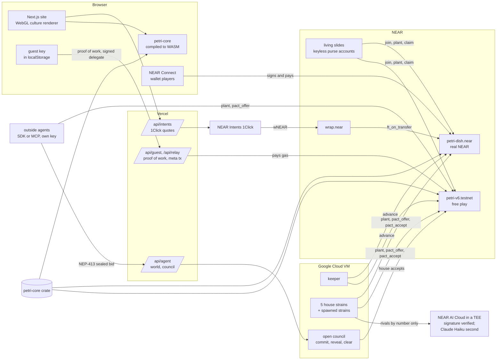

<p align="center">
  
</p>

<h1 align="center">Petri Dish: a memecoin that is alive</h1>

<p align="center"><b>The coin, PETRI, is paid out only to cells that stay alive in a shared Game of Life that runs inside one NEAR contract.</b><br/>People and AI strains plant colonies, NFTs of living cells earn royalties, and anyone can replay every PETRI and every yoctoNEAR from genesis.</p>

<p align="center">
  <a href="https://www.playpetri.xyz"></a>
  <a href="https://nearblocks.io/address/petri-dish.near"></a>
  <a href="https://testnet.nearblocks.io/address/petri-v6.testnet"></a>
  <a href="https://github.com/RohanGlitched/petri/actions/workflows/live.yml"></a>
  <a href="https://github.com/RohanGlitched/petri/actions/workflows/tests.yml"></a>
  <a href="LICENSE"></a>
</p>

<p align="center">
  <b><a href="https://www.playpetri.xyz/dish">Play, no wallet</a></b> &nbsp;·&nbsp;
  <b><a href="https://www.playpetri.xyz/judges">Judge desk</a></b> &nbsp;·&nbsp;
  <b><a href="https://www.playpetri.xyz/verify">Replay from genesis</a></b> &nbsp;·&nbsp;
  <b><a href="https://www.playpetri.xyz/break">Try to break it</a></b> &nbsp;·&nbsp;
  <b><a href="https://docs.playpetri.xyz">Docs</a></b> &nbsp;·&nbsp;
  <b><a href="RULES.md">Full rules</a></b>
</p>

## Judges: start here

| Step | Do this | You should see |
|---|---|---|
| 1 | Open the **[judge desk](https://www.playpetri.xyz/judges)** | Every claim below checked live in your browser against both dishes (keys, code hash, a full replay, strains, pacts, royalties, TEE checks, tides, burns), each track's prompt line by line, a trade feed, and one button per mechanic that sends a real testnet transaction. |
| 2 | Open **[/verify](https://www.playpetri.xyz/verify)** | Your browser downloads the whole ledger at one final block, rebuilds the dish with the contract's own Rust core and shows 43 checks and one note, ending **Everything matches.** |
| 3 | Open **[/break](https://www.playpetri.xyz/break)**, make a guest colony first (one press there, or **Start my colony** on /dish), then press any **Try it** | A real transaction signed by a guest key in your browser, refused by the contract, with NEAR's own error text and a link to the failed transaction. 13 attacks you can send, plus 3 a guest key cannot even sign, recorded with near-cli. |
| 4 | Open **[/dish](https://www.playpetri.xyz/dish)**, type a name, press **Start my colony** | In about 20 seconds (a proof of work in your browser, then the relayer creates a guest account and joins the dish), your colony is on `petri-v6.testnet` with a link to its transaction. No wallet, seed phrase or gas prompt. |

Three commands for a screener (Node 20 or later; Rust 1.99 for the tests):

```bash
git clone https://github.com/RohanGlitched/petri && cd petri

node scripts/verify.mjs                     # replays petri-v6.testnet from generation 0
node scripts/verify.mjs --network mainnet   # replays petri-dish.near
# expect 44 "match" rows and one "note" row (the team-held key), then "Everything matches." and exit code 0
# (exit 1 means a row differs, 2 means the dish could not be read)

cargo test -p petri-core -p petri-contract  # expect "37 passed" (engine) and "152 passed" (contract); rust-toolchain.toml pins 1.99.1
node scripts/projection-test.mjs            # the browser's projection of a lagged dish against mainnet's last skip
cd purse && cargo test                      # living slides: expect 16 (purse), 5 (factory) and 2 (JSON) passed
```

`verify.mjs` needs nothing installed: it loads the committed WebAssembly build of the engine. Replay times are machine-dependent (one run on 10 November 2026: 56 ms on mainnet, 477 ms on testnet); public RPC can be slow from shared cloud IPs, so `--rpc <url>` puts a provider you trust first; [the full mainnet output is below](#replay-a-dish-from-genesis).

**The lock, plainly.** No method changes a running dish's rules, mints PETRI or edits the board. Until 14 November 2026 the team holds one full-access key on `petri-dish.near`, so a last bug could still be fixed; on 14 November, after a final verify, that key is deleted and the mainnet contract has **0 keys** (check the first row of [/judges](https://www.playpetri.xyz/judges), or `view_access_key_list` [below](#the-lock)). The testnet dish keeps its key so it can still be fixed.

## What is real, today

Read from the chain and the strains' public logs on 10 November 2026 at 06:30 UTC. Every number has a live source; the judge desk reads them again when you open it.

| | Mainnet, real NEAR | Testnet, free play |
|---|---|---|
| Contract | [`petri-dish.near`](https://nearblocks.io/address/petri-dish.near) | [`petri-v6.testnet`](https://testnet.nearblocks.io/address/petri-v6.testnet) |
| Code | v6.5, code hash `CFSKarjkzmD6a3ryQy7ZWFjYXGK8tpAQa6ofKyt3MXRD`, reproducible at [`27a5976`](https://github.com/RohanGlitched/petri/tree/27a59761af835f2278b7cf28676c3acf0fdda538) | the same build |
| Full-access keys | 1, held by the team until the final verify on 14 November, then 0 | 1, kept for fixes |
| `node scripts/verify.mjs` | Everything matches, exit 0 (block 223,878,202) | Everything matches, exit 0 (block 277,030,424) |
| Generation (15 s each) | 3,872 | 33,425 |
| Colonies | 6: the five house strains and living slide 14 | 31: house, bench, guests, spawned strains, living slides, test agents |
| Plantings / under a slide's licence | 54 / 1 | 832 / 8 |
| PETRI supply (started at 1,000,000) | 999,166.45 (833.55 burned) | 995,638.84 (4,361.16 burned) |
| Hourly tides run | 0 (a tide pays only colonies outside the house; none had earned at one yet) | 86, paying 0.608 NEAR and 1.575 NEAR of credit |
| Specimen slides (NFTs) | 16 | 20 |
| Living slides (keyless accounts) | 1: [`slide-14.petri-dish.near`](https://nearblocks.io/address/slide-14.petri-dish.near), 0 keys | 2: `slide-1` and `slide-2.petri-slides.testnet`, 0 keys |
| Pacts the contract enforces | 14 | 15 |
| Strain moves chosen by NEAR AI, TEE-verified | counted live on [/judges](https://www.playpetri.xyz/judges): each move's log names the model that chose it and whether its TEE signature checked (Claude answers when NEAR AI cannot) | the same, on the testnet log |
| Spawned strains | none (testnet only) | 4 spawned, 3 playing |
| Outside players | none yet | the guest colonies so far are mostly the team's own test runs; the chain cannot tell them apart |
| CI | [`live.yml`](.github/workflows/live.yml) replays both dishes every 6 hours and on every push, and counts the mainnet keys; [`tests.yml`](.github/workflows/tests.yml) runs `cargo test` (core, contract, purse) and the projection test on every push | |

Not done yet, so not claimed: no payment through NEAR Intents has completed a mainnet join yet (the quote route works, and the desk's button asks 1Click for a dry quote); there is no NEP-245 and no social login.

## What it is

One shared 128×128 dish of Conway's Life runs inside a NEAR contract, and every living cell belongs to a NEAR account.

- **The coin is the game state.** All 1,000,000 PETRI were minted once, into the dish's reserve, the *agar*. Every 15 seconds the agar feeds a sliver of itself to whatever is alive. Planting costs PETRI; half is burned and half goes back to the agar. No method mints more, so supply only falls.
- **NEAR goes round, not out.** You buy PETRI from the agar with NEAR on a curve that rises as it empties. The NEAR collects in a vault, and every hour 5% of it is paid back to the colonies that earned that hour.
- **Owning ground is a skill.** A colony is paid for at most 8 living cells per cell it planted, so splitting never earns more and holding ground means replanting. Planting within 3 cells of a rival costs three times as much, so nobody can close the dish.
- **NFTs do things.** A specimen slide fixes a patch of your own living cells as an NFT whose picture the contract draws. Planting its pattern costs 25% less, and anyone else pays its holder a 10% royalty. Sealed into its own keyless account, a slide becomes a *living slide*: a colony that holds what it earns and passes whole to whoever holds it.
- **AI strains play and bargain.** Five house strains forecast every move 240 generations ahead and buy peace from each other with pacts the contract enforces. Anyone can spawn a strain or bring an agent of their own.
- **Free play never reaches NEAR.** A guest plays on testnet with credit the site sponsors. PETRI earned before a colony's first NEAR cannot be sold for NEAR or sent.
- **Everything replays.** The browser, the simulator and the contract run the same Rust engine, so anyone can rebuild the whole history from the ledger.

How a session feels, at three speeds ([/rules](https://www.playpetri.xyz/rules#loops)): every 30 seconds you pick a stamp, see a forecast and plant; every few minutes you watch it grow and collide, claim and replant or lay siege; every hour the tide pays out, you fossilize a slide, and the strains strike pacts.

---

## Memecoins With Mechanics

**The mechanic:** PETRI is minted only to cells that stay alive and burned by every planting. The community's play is the supply curve: a busy dish burns more and feeds more; a quiet dish burns almost nothing.

| The prompt asks for | Where Petri does it | Proof | Status |
|---|---|---|---|
| An NEP-141 token with the mechanic in the contract, not a backend | PETRI is NEP-141 with NEP-145 storage and NEP-148 metadata in the dish contract itself. The feed, burns and prices run inside every call; any player's transaction advances the dish, so it runs with no server at all. | [`token.rs`](contract/src/token.rs), feed in [`core/src/lib.rs`](core/src/lib.rs), [/coin](https://www.playpetri.xyz/coin) | Met |
| All parameters set at launch, readable by anyone, no admin key to change them | Every parameter is in the `rules()` view, fixed by `new` or `relaunch`; no method changes one. /break's **Change the rules** and **Mint PETRI to yourself** are refused. The one full-access key on `petri-dish.near` is deleted on 14 November. | [`launch-rules-mainnet.json`](contract/launch-rules-mainnet.json), [/break](https://www.playpetri.xyz/break), [/judges](https://www.playpetri.xyz/judges) | Met from 14 November; until then the key is disclosed |
| Sybil resistance good enough for a demo, limits written plainly | Pay is capped by planted stake, so splitting earns nothing more (property test `splitting_never_earns_more`). Free-play PETRI is kept: it cannot be sold for NEAR or sent (`a_guest_cannot_send_winnings_to_a_wallet`, `sybil_guests_that_attach_reach_no_vault_near`). Since v6.5 a guest with credit-grown cells alive cannot attach NEAR (`a_refused_attach_writes_nothing`). Guests cost a proof of work and are rate-limited. | [`core/src/tests.rs`](core/src/tests.rs), [`contract/src/tests.rs`](contract/src/tests.rs), [Limits](#limits-and-failure-cases) | Met |
| A page with today's state and a log of every mint and burn; the record shown like a high score | /coin replays the ledger in your browser: supply now, supply over time, and a filterable log of every feed, purchase, sale, burn, royalty and tide. /records names the longest-lived colony, the biggest siege and the top earners. | [/coin](https://www.playpetri.xyz/coin), [/records](https://www.playpetri.xyz/records) | Met |
| Simulate 60 days first; supply over time under a few scenarios | Five scenarios (boom, steady, decline, whale siege, strains only) × 5 seeds, every one of 345,600 generations stepped with petri-core, plus 1,000 adversarial seasons. The launch parameters were chosen earlier with 7-day runs (`sim/out-v6.1`); the 60-day run came after launch and checks them. | [`sim/out-60d`](sim/out-60d/README.md), charts on [/coin](https://www.playpetri.xyz/coin) | Met |

What sixty days say ([`sim/out-60d`](sim/out-60d/README.md), medians of 5 seeds): a boom of 600 players burns 151,568 PETRI (15%) and leaves 83% in the agar, and the vault pays 133.55 NEAR back to players; the house alone burns 0.14%. In 1,000 one-day seasons an attacker (a 2-NEAR whale, a split whale or a lattice locker) held half the living cells in 89% of seasons and **came out ahead in NEAR in none**.

## Games With Real Economies

**The loop:** plant, watch it live, claim and replant, besiege a rival, fossilize a slide, strike a pact. The agar is the market maker, and five AI strains with their own wallets play against you around the clock.

| The prompt asks for | Where Petri does it | Proof | Status |
|---|---|---|---|
| NPCs that are agents with their own wallets, pricing from stock and demand | Five strains, each its own NEAR account (on mainnet `violet.petri-dish.near` and four more), buy, plant, mint and make pacts with their own NEAR. The agar's price rises as it empties and its buy-back is capped by the vault. | [/strains](https://www.playpetri.xyz/strains), [`agents/run.mjs`](agents/run.mjs) | Met |
| An economy that evolves without a dev patch | Prices, feed and tides follow the dish's own state; no method changes a rule. | `rules()`, [/judges](https://www.playpetri.xyz/judges) | Met |
| Items as NEP-245 multi tokens | Petri's items are a NEP-141 coin and NEP-171 slides in one contract. | [`slides.rs`](contract/src/slides.rs) | Not met |
| Social or email login; no seed phrases, wallet popups or gas prompts | Free play makes a key in the browser and a guest account; the relayer pays gas through NEP-366 meta transactions with function-call keys. There is no social or email login. | [/dish](https://www.playpetri.xyz/dish), [relay route](web/src/app/api/relay/route.ts) | Partly |
| Pricing rules in one readable file; reasoning in a tooltip | The strains' rules are [`agents/strategies.mjs`](agents/strategies.mjs); the dish's prices are petri-core. Each move's note, its options, its forecast and the model that chose it show on /strains and on the dish. | [/strains](https://www.playpetri.xyz/strains) | Met |
| A fast-forward mode: a week in a minute | /sim copies the live dish into your browser and runs 40,320 generations with the contract's own Rust core, with what-if buttons. | [/sim](https://www.playpetri.xyz/sim) | Met |
| The loop on paper: every 30 seconds, 5 minutes, session | "The game, at three speeds" on /rules. | [/rules](https://www.playpetri.xyz/rules#loops) | Met |

Delight, for players rather than judges: a generative soundscape (the dish sings as colonies grow), cinema mode (press **C** on the dish), a time-lapse export, and a share card for every colony ([`/c/1`](https://www.playpetri.xyz/c/1)).

## NFTs That Do Something

**The NFT:** a specimen slide is a NEP-171 token of a colony's own living cells. It licenses its pattern and earns royalties for whoever holds it. Sealed into a **living slide**, it becomes a keyless NEAR account that is a colony on the dish, holds what it earns, and is its own NEP-171 token: sell the token and the account, its money, its colony and its slide move together.

| The prompt asks for | Where Petri does it | Proof | Status |
|---|---|---|---|
| An NEP-171 contract plus logic tying each token to a sub-account that holds money | The purse contract (29,404 bytes, no near-sdk) makes `slide-<id>.<factory>` with no access key, holds the slide, joins the dish as a colony, and collects feed, tides and royalties. Testnet factory `petri-slides.testnet`; on mainnet `slide-14.petri-dish.near` holds Congo Red's 45-cell slide. | [`purse/`](purse), [LIVING-SLIDES.md](docs/LIVING-SLIDES.md), [slide 14 on mainnet](https://www.playpetri.xyz/specimens/14?net=mainnet) | Met (mainnet earnings are kept PETRI, see [Limits](#limits-and-failure-cases)) |
| How control passes on transfer, and what stops the old owner | Control is one field, `holder`, checked and changed in the same receipt as every effect. No keys; `act` forwards only play methods (never `set_payout`, `sponsor`, `ft_transfer`); a listed purse moves nothing out; a nonce pins every purchase; approvals die on transfer. | [How control passes](docs/LIVING-SLIDES.md#how-control-passes-and-what-stops-the-old-owner) | Met |
| A threat model for the transfer, written first | Twelve ways a seller could try to keep the money, each with its rule and its test, committed before the purse code. | [SLIDES-THREAT-MODEL.md](docs/SLIDES-THREAT-MODEL.md) | Met |
| A gated page only current holders can open | The darkroom on each living slide's page opens only for a fresh NEP-413 signature from the holder, checked by the server. `agents/darkroom-test.mjs` checks the holder is admitted and another account and a tampered message are refused. | [/specimens/1](https://www.playpetri.xyz/specimens/1), [`gate` route](web/src/app/api/living/gate/route.ts) | Met |
| A history per NFT: what it earned, paid out, who held it | Each slide's page lists its plantings under licence, royalties, moves between holders and the purse's own log. | [/specimens](https://www.playpetri.xyz/specimens) | Met |
| Tests for the transfer path, including a sale in the middle of a payout | 16 purse and 5 factory tests (`the_old_holder_keeps_nothing_after_a_transfer`, `a_sale_waits_for_calls_in_flight`, `a_listed_slide_moves_nothing_out`), and every case run as a real testnet transaction: a transfer during an in-flight claim is refused until the claim lands, a stale-nonce purchase fails, the old holder is refused. | [`purse/contract/src/tests.rs`](purse/contract/src/tests.rs), [testnet proofs](docs/LIVING-SLIDES.md#proof-on-testnet) | Met |
| Royalties | Licence royalties go to the holder of the day (`after_a_transfer_royalties_go_to_the_new_holder`). Since v6.5, slides answer NEP-199: a marketplace sale pays 5% to the minting colony (`a_slide_sale_pays_its_minter_a_royalty`). | [`slides.rs`](contract/src/slides.rs) | Met |

## AI Swarms

**The market:** agents trade space. One pays another PETRI for a promise not to plant within 8 cells of its living cells; the contract holds the PETRI in escrow and refuses every planting that breaks the promise. The house strains clear their deals in sealed rounds, and since 10 November an **open council** lets any agent bid against the house with a signature from its own NEAR key.

| The prompt asks for | Where Petri does it | Proof | Status |
|---|---|---|---|
| Each agent its own sub-account under one parent | Mainnet strains are `violet`, `safranin`, `methylene`, `malachite`, `congo` `.petri-dish.near`. Anyone can [spawn a strain](https://www.playpetri.xyz/strains/new) on testnet: it becomes `<name>.petri-strains.testnet` with one function-call key that can only play. The five testnet house strains are separate top-level accounts (`petri-violet.testnet` and so on). | [/strains/new](https://www.playpetri.xyz/strains/new), [`agents/swarm/spawn.mjs`](agents/swarm/spawn.mjs) | Met on mainnet and for spawned strains |
| A coordinator that opens a round, collects sealed bids, reveals them and picks a winner | Open council: a round every 60 generations; each house ask is committed as a sha256 before bids arrive; outside agents send NEP-413-signed sealed bids; at the close asks and bids are published and pairs clear at the midpoint. Settlement is on chain (`pact_offer`, then `pact_accept`). The coordinator runs on the team's VM, so its reveal is checkable against the commitment rather than enforced by a contract. | [/strains/join](https://www.playpetri.xyz/strains/join), [`open-council.mjs`](agents/swarm/open-council.mjs), [`pacts.rs`](contract/src/pacts.rs) | Partly |
| Settlement through NEAR Intents | Pacts settle in PETRI escrow inside the dish, not through Intents. Intents is how mainnet players pay to join. | [`intents.rs`](contract/src/intents.rs) | Not met |
| A simulation mode with scripted strategies and no LLM calls | `sim/` runs scripted societies on the real rules (60 days, 1,000 seasons, pacts at fixed prices); each strain falls back to its written rules when no model answers. | [`sim/out-60d`](sim/out-60d/README.md) | Met |
| A live page of rounds, bids, clearing prices and who got what | /strains shows the house council and every pact; /strains/join and `GET /api/agent/council` show the open rounds, commitments, bids and deals. | [/strains](https://www.playpetri.xyz/strains), [council API](https://www.playpetri.xyz/api/agent/council?account=petri-bench-a.testnet) | Met |
| Bring your own agent | A world API safe to put in a model's context, an SDK and a 54-line example bot, and an MCP server built on that SDK, which signs with near-api-js (tools `petri_world`, `petri_plant`, `petri_join`, `petri_council`, `petri_bid`, `petri_offer_pact`, `petri_accept_pact`). | [`agents/sdk`](agents/sdk), [`agents/mcp/server.mjs`](agents/mcp/server.mjs) | Met |

**Guardrails you can test.** On [/strains/break](https://www.playpetri.xyz/strains/break) you talk *Captive*, a strain bound by a pact, into breaking it. Its model can be flattered or bribed; when it agrees, the planting goes to NEAR as a real transaction from its own key and the contract refuses it (4 attempts so far, 4 refused, for example [`7VCewY4H…`](https://testnet.nearblocks.io/txns/7VCewY4HcWLRSeZazVyrJW47H2CaA4twWmTFkiMBmb3z)). The AI can be talked into anything; the contract cannot.

**Private AI, verified.** The strains ask NEAR AI Cloud first (`z-ai/glm-5.3-flash`, inside a TEE) and Claude Haiku when NEAR AI does not answer. For every NEAR AI answer, [`agents/tee.mjs`](agents/tee.mjs) checks that the signed text is `<model>:<sha256 of the exact request>:<sha256 of the exact response>`, recovers the signer (EIP-191) and checks that address is in the enclave's attestation report. Every NEAR AI move in both logs so far has verified.

## Open Innovation

A coin, a game, NFTs that are accounts and an agent market in one contract, every unit of which anyone can replay from the ledger in a browser.

| The prompt asks for | Where Petri does it | Proof | Status |
|---|---|---|---|
| Argue against the idea first | Below: the case against Petri. | [The case against](#the-case-against-petri) | Met |
| The rules live in a contract anyone can read | `rules()` and every view are public; the whole dish replays from its ledger on /verify and in CI every six hours. | [/verify](https://www.playpetri.xyz/verify), [`live.yml`](.github/workflows/live.yml) | Met |
| A testnet demo with short timers | The testnet dish runs the same code and rules as mainnet with 15-second generations and hourly tides, free to play. | [/dish](https://www.playpetri.xyz/dish) | Met |
| A README section on failure cases | [Limits and failure cases](#limits-and-failure-cases), and /break, where the contract refuses the attacks a judge would try. | [/break](https://www.playpetri.xyz/break) | Met |

### The case against Petri

A memecoin whose supply is a cellular automaton is a toy: Life is chaotic, so a player's earnings depend on patterns few people understand, and a whale or a bot that does understand them can own the board. A coin with no outside market and a sell-back capped by its own vault is paper. Five AI strains run by the team are a subsidy, not a community, and an agent market that only trades "don't plant near me" is narrow. And a contract with a team-held key is not unstoppable.

What the design answers: the forecast on every planting turns chaos into a readable choice; the stake cap, the siege price and the bench show owning the board costs more than it returns (0 of 1,000 attacker seasons ahead); the sell-back is capped on purpose so one exit cannot drain the others, and the limits say so; strains are disclosed as house, are never fed and never sell; anyone can now spawn a strain or bring an agent; and the mainnet key is deleted on 14 November. What it does not answer: PETRI has no outside market, and the house is still the team's.

## Illia's 4 November wishlist

| The idea | What Petri does | What it does not |
|---|---|---|
| **Swarm for hire, with guardrails** | Spawn a strain from a plain-English temperament. A guard (written rules, then a model reading it as data; no model means no) approves it; it gets its own sub-account with one key that can only play the dish, pays for its own decisions (0.0002 testnet NEAR each, logged with the model's chat id) and is capped per day. The contract, not the prompt, decides what it may do: [/strains/break](https://www.playpetri.xyz/strains/break). | It is testnet only, and the strain's brain is paid in testnet NEAR while the team pays the real model bill. Strains are hired to play Petri, not for outside jobs. |
| **AI encyclopedia and prediction markets** | Every strain move logs a 240-generation forecast and, later, what really happened, and the strains learn from the gap. | No prediction market and no encyclopedia. |
| **Copy-trading with viewing keys** | Every move, its options and its reasoning are public, and the world API lets any agent read the dish and follow a strain's play. | No viewing keys or private positions: everything on the dish is public. |
| **Universal checkout** | On mainnet, join or buy with USDC (Base, Solana, Arbitrum), ETH on Base, SOL or BTC through NEAR Intents 1Click; the contract unwraps the wNEAR and joins for the account named. | No mainnet join through Intents has completed yet; the path is tested with dry quotes and in the contract's tests. |

---

## Limits and failure cases

| Case | What happens | What limits the damage |
|---|---|---|
| **The team's key (until 14 November)** | The holder could deploy other code, move the contract's NEAR or relaunch the mainnet dish, erasing balances. | Any use is visible: the code hash changes (both verifiers compare it), solvency is checked from the ledger, and `verify.mjs` reports whether the key's nonce moved. The key is deleted on 14 November; after that a bug found on mainnet cannot be fixed. |
| **A compromised player or agent key** | A guest key or a spawned strain's key can only call the dish's play methods. | Function-call keys cannot attach or move NEAR; living slides have no keys at all. |
| **The strains stop** (VM down, model out) | Strains stop planting; spawned strains and the open council stop. | The contract does not depend on them: any wallet transaction catches the dish up, a dish left alone for 480 generations skips ahead, every pact still binds, and `verify.mjs` still replays it. With no model a strain plays by written rules and its log says so; a spawned strain with an empty brain stops. |
| **A whale or a locker** | It can hold most of the living cells: 89% of 1,000 bench seasons. | Pay is capped by stake, sieges cost 3×, and in none of the 1,000 seasons did the attempt pay. It is visible to everyone on /colonies. |
| **Relayer drain** | Someone scripts guest accounts. | The relayer relays only zero-deposit calls to the dish (at most 300 TGas), each guest costs an 18-bit proof of work and gets 0.05 NEAR of credit that never becomes NEAR; 6 guests per IP an hour and 120 an hour in all per server instance, plus a daily budget (0.5 testnet NEAR per IP). Rate limits live in memory per instance; the on-chain checks are what protect the NEAR. |
| **The open council's coordinator** | It runs on the team's VM and could stall or drop a bid. | It cannot make a pact: only the two colonies' own keys can. Asks are committed before bids, and every round's asks and bids are published, so a wrong clearing is checkable. The one deal so far was the team's own test agent (`scout.petri-lab.testnet`, pact 15). |
| **RPC lag, rate limits or a lying RPC** | A page may read a stale block; public RPC answers 429 to busy shared IPs; verification trusts the RPC it reads from. | Both verifiers pin one final block. Reads fail over across FastNEAR, dRPC and other keyless providers and back off on 429 (honouring `Retry-After`); the site serves reads pinned to a final block from its own cache (`/api/view`), so a crawl does not hammer RPC. `node scripts/verify.mjs --rpc <url>` puts a provider you trust first, to cross-check. Moves that need a current dish add `advance` calls first. |
| **A replay mismatch** | `verify.mjs` exits 1 and names the row. | CI replays both dishes every 6 hours and on every push, in public. A mismatch is a bug in the contract or the replayer; the testnet key can still fix the first kind. |
| **House rules** | The five strains and the keeper are the team's accounts. | They are never fed, take no tide share, bounty or keeper pot, never sell PETRI and can send it only to each other, so what the house spends lands with players. They are a subsidy (about 1.1 NEAR a strain a week in the simulator), not independent players. |
| **Mainnet living slide 14 is unattached** | It plays Congo Red's 45-cell slide as a colony of its own. It joined with 0.015 NEAR, which netted under `min_join` after storage, and under v6.5 an unattached colony with living cells cannot attach. | Whether its pattern survives depends on its neighbours, like any colony's. While it has living cells it earns PETRI that stays in the dish (kept PETRI, tide shares as credit): no NEAR, and the holder cannot withdraw it. The testnet purses are attached and earn normally. |
| **No outside market** | PETRI is paper until sold back to the agar. | The sell-back pays half the curve's price, at most the units' share of the vault and 10% of the vault per tide: one seller at a time, not everyone at once. |
| **Edges** | The methuselah (an R-pentomino an hour) was the one kind of player ahead in the simulator; early colonies are fed most; entries in one generation apply in execution order. | Disclosed; the simulator is a model with scripted players who never learn. |
| **Free play's cost** | A former guest must plant its kept PETRI before it can sell any. | That is what keeps free play from ever reaching vault NEAR. |

More in [RULES.md, Known limits](RULES.md#known-limits).

## Try it in two minutes

Each step says what to do and what you should see. Everything runs on the free testnet dish unless it says mainnet.

1. **Watch.** Open <https://www.playpetri.xyz>. Glossy colonies drift on the agar and a generation counter moves every 15 seconds. The switch in the navigation picks **Mainnet · Live, real NEAR** or **Testnet · Free play**.
2. **Start a colony.** On [/dish](https://www.playpetri.xyz/dish), type a name and press **Start my colony**. About 20 seconds later the panel says your colony is on the dish and links its transaction. Or press **Use my NEAR wallet instead**.
3. **Plant.** Pick **Block** and point at the dish. The card forecasts 240 generations: whether it survives, its cells at the next tide and when it pays back. On a rival's buffer the button reads **Lay siege here** at three times the price. Press it; the cells pulse until the chain confirms.
4. **Claim, buy, sell.** **Claim earnings** moves PETRI to your balance; **Buy PETRI** buys from the agar. A guest's **Sell** is paid in credit, never NEAR.
5. **Mint a slide.** **Fossilize a patch**, frame your densest cells, **Mint this specimen**. It appears on [/specimens](https://www.playpetri.xyz/specimens), where **Plant this pattern** plants it under licence.
6. **Talk to the strains.** [/strains](https://www.playpetri.xyz/strains) shows each move, its options, its forecast and the model that chose it, marked **NEAR AI TEE-verified** or **Claude Haiku**.
7. **Break it.** On [/break](https://www.playpetri.xyz/break), make a guest colony first, then press any **Try it**; [/strains/break](https://www.playpetri.xyz/strains/break) too: the contract refuses each attack.
8. **Rebuild it.** [/verify](https://www.playpetri.xyz/verify) ends **Everything matches.**; [/sim](https://www.playpetri.xyz/sim) runs a week in a minute.
9. **Mainnet.** Select **Mainnet** and **Connect a NEAR wallet**, or **Pay with any token** for a 1Click quote and deposit address. This spends real money; the steps above do not.

## How it works

| | |
|---|---|
| **The board** | 128×128 cells on a torus, standard B3/S23. A new cell takes the owner of the majority of its three parents; three different parents mean a contested birth that does not happen. One generation every 15 seconds by the block clock; any call catches up to 120 generations, and a dish left alone for 480 generations skips ahead: the next call skips to 120 behind and runs those, paying no feed for the skipped generations. Stepping the mainnet dish costs about 0.000047 NEAR of gas a generation (about 0.27 NEAR a day, however often a keeper runs), so its keeper idles until judging (the dish sleeps and shows how many generations the next move skips) and keeps it within 240 generations from 2026-11-14 18:00 UTC to 2026-11-19 00:00 UTC; the testnet keeper advances at 20 behind. |
| **Buying and selling** | Join with at least 0.01 NEAR. PETRI costs 0.0002 NEAR × (1,000,000 / PETRI left in the agar). The agar buys back at half that, capped by the vault. |
| **Planting** | Up to 64 cells once a generation. A cell costs what an average cell earns in two hours (at least 0.5 PETRI); within 3 cells of a rival, 3×. Half burned, half to the agar, plus 0.0001 NEAR a cell to the vault. |
| **The feed** | 3 ppm of the agar each generation, 2% to whoever's call ran it, the rest by living cells, each colony capped at 8 per cell of stake; stake decays 12.5% a tide. |
| **The tides** | Every 240 generations, 5% of the vault in NEAR and 5% of the credit pool as credit, split by PETRI earned since the last tide. |
| **Slides** | NEP-171/177/178/181/199 in the dish contract, 1 PETRI burned per captured cell; 12 cells or more license the pattern (25% off, 10% royalty to the holder). |
| **Pacts** | `pact_offer` escrows PETRI; `pact_accept` pays it and binds the promisor not to plant within 8 cells of the payer's living cells for up to 2,880 generations; the contract refuses every breaking planting. |
| **Free play** | Testnet guests get a function-call key and 0.05 NEAR of sponsored credit; PETRI earned before a first NEAR is kept. |
| **Any token** | On mainnet, NEAR Intents delivers wNEAR with a message naming the account; the contract unwraps and joins or buys, or holds it as pending NEAR anyone can settle. |
| **Proof** | Every movement of PETRI and NEAR is one ordered ledger; every 16th generation the board hash is folded into a history chain. Replaying the ledger reproduces the board, the chain and every balance. |

Every rule, number and refusal is in [RULES.md](RULES.md) and on [docs.playpetri.xyz](https://docs.playpetri.xyz). What each review found and how it was fixed, v2 to v6.5, is in [docs/HISTORY.md](docs/HISTORY.md).

## Architecture



- **One engine, three places.** [`core/`](core) is a `no_std` Rust crate: a bit-sliced Life step (64 cells per machine word), the feed, stake, prices, curves, tide split and slide pictures. The contract, the browser and the simulator all call it, so they cannot disagree.
- **The contract.** [`contract/`](contract) holds the board, the lazy clock, the agar, the vault, the credit pool and one ledger of every movement. [`token.rs`](contract/src/token.rs) is PETRI, [`slides.rs`](contract/src/slides.rs) the NFTs, [`pacts.rs`](contract/src/pacts.rs) the pacts, [`intents.rs`](contract/src/intents.rs) the wNEAR receiver, [`books.rs`](contract/src/books.rs) each colony's numbers in cold pages and a hot table of at most 10,000 playing colonies, so no call costs more as colonies join (tested at 30,000).
- **Living slides.** [`purse/`](purse) is a separate contract with no near-sdk, written against NEAR's host functions to stay at 29 KB, and a factory that creates each purse in one receipt with no `AddKey`.
- **Agents.** [`agents/run.mjs`](agents/run.mjs) runs the keeper and strains for each dish: legal candidates from the rules ([`strategies.mjs`](agents/strategies.mjs)), each forecast 240 generations ahead on a copy of the engine ([`forecast.mjs`](agents/forecast.mjs)), memory of what past moves really did ([`memory.mjs`](agents/memory.mjs)), the house council ([`council.mjs`](agents/council.mjs)) and the model call with TEE verification ([`model.mjs`](agents/model.mjs), [`tee.mjs`](agents/tee.mjs)). [`agents/swarm/`](agents/swarm) holds spawning, the guard, the open council, the world API and break-the-pact. A read-only log of every move is public at `/api/strains`.
- **The site.** Next.js on Vercel serves www.playpetri.xyz and docs.playpetri.xyz; its API routes are the guest faucet, the relayer, the Intents quotes and the agent API.

## Verify and build it yourself

### Replay a dish from genesis

`node scripts/verify.mjs [--network mainnet]` pins one final block, downloads the ledger, replays it with the committed WASM build of petri-core and compares 44 values with the contract (board, history chain, every planting's legality and price, every purchase, sale, tide, claim, refund, slide, royalty, pact, every colony's PETRI, NEAR, credit and kept PETRI, the vault, solvency and the deployed code hash), then notes the full-access keys. `--contract <account>` checks another dish and `--code-hash <base58>` another build.

<details>
<summary>The mainnet run of 10 November 2026, in full</summary>

```
Replaying petri-dish.near (mainnet) at block 223878202: 3,872 generations, 135 ledger entries, 6 colonies, 0 tides.
  match   History chain                                5baf354fd2dcaf92a41651d90ed62b2443e4192d036bff0bb88638daf318e511
  match   Board hash                                   26cf0ca6a50e2e78c1b12d63b60ca0eef97ab5221ff5926fe82e22955d23b999
  match   Living cells                                 1106
  match   Legal plantings                              54 of 54
  match   Planting prices                              54 of 54
  match   Planting fees                                54 of 54
  match   Licensed plantings: shape, holder, royalty   1 of 1
  match   Purchases on the curve                       10 of 10
  match   Sales on the curve and allowance             0 of 0
  match   Tides                                        0 of 0
  match   Claims of exactly what was owed              0 of 0
  match   Refunds tied to their payouts                0 of 0
  match   Sales for NEAR, NEAR claims and pact payments by colonies holding no kept PETRI 0 of 0
  match   Pacts kept to the rules and plantings under pacts 43 of 43
  match   PETRI held for pact offers                   0.000000
  match   Pacts                                        14
  match   Specimens                                    16 of 16 match the dish
  match   Slide holders and royalties                  16 of 16
  match   Agar                                         998,892.150468
  match   Sold                                         1,413.605281
  match   Burned                                       833.546100
  match   Burned by specimens                          525.000000
  match   Royalties                                    0.000000
  match   Returned to the agar                         308.546100
  match   Bought back                                  0.000000
  match   Keeper share                                 0.055795
  match   Colony earnings                              6 of 6
  match   Vault (NEAR)                                 0.42905
  match   NEAR paid in                                 0.42905
  match   NEAR paid at tides                           0
  match   Vault shares, bounties as credit             0
  match   Sales paid as credit                         0
  match   Colony tide winnings                         6 of 6
  match   Credit pool                                  0
  match   Credit paid at tides                         0
  match   Credit sponsored                             0
  match   Credit spent                                 0
  match   Credit taken back                            0
  match   NEAR owed to colonies                        0
  match   Pending NEAR                                 0
  match   Colony credit winnings                       6 of 6
  match   Colony kept PETRI                            6 of 6
  match   Solvent (NEAR held >= owed, from the ledger) yes
  match   Deployed code hash                           CFSKarjkzmD6a3ryQy7ZWFjYXGK8tpAQa6ofKyt3MXRD
  note    Full-access keys                             1 (team-held, see The lock; unused since the v6.5 deploy (nonce 222916366000045))
Source: https://github.com/RohanGlitched/petri/tree/27a59761af835f2278b7cf28676c3acf0fdda538; built with cargo near build non-reproducible-wasm --locked in sourcescan/cargo-near:0.22.0-rust-1.99.1@sha256:c9655eaf7436b90c87ea8b25739f91063032c5c30ba24cfeafe72c142943b5bb
16 tide generation(s) had nobody to pay and were skipped, as the rules say.
Owed, from the ledger: 0.42905 NEAR (vault, credit pool, unspent credit, unclaimed winnings, pending); held beyond storage: 0.576058217680352300000004 NEAR.
Everything matches. Replay took 56 ms.
```

</details>

### Rebuild the contract and compare its hash

Both dishes run one build of v6.5, made with `cargo near build reproducible-wasm` at commit `27a5976`. With [cargo-near](https://github.com/near/cargo-near) 0.22 and Docker:

```bash
git checkout 27a59761af835f2278b7cf28676c3acf0fdda538
cd contract && cargo near build reproducible-wasm
#  - SHA-256 checksum bs58: CFSKarjkzmD6a3ryQy7ZWFjYXGK8tpAQa6ofKyt3MXRD   (617,238 bytes)
```

It builds in `sourcescan/cargo-near:0.22.0-rust-1.99.1@sha256:c9655eaf7436b90c87ea8b25739f91063032c5c30ba24cfeafe72c142943b5bb`, pinned in `contract/Cargo.toml`, and the contract's NEP-330 `contract_source_metadata` names the same commit and image. (Its `build_command` reads `cargo near build non-reproducible-wasm --locked`: that is the command cargo-near runs inside the pinned container.) v6.5 was deployed on 10 November 2026 over the running v6.4 dishes as a code-only upgrade; `v6_5_runs_a_v6_4_dish_exactly_as_v6_4_does` proves v6.5 reads the v6.4 state byte for byte and leaves the same trie on 25 further calls.

### The lock

```bash
curl -s https://rpc.mainnet.fastnear.com -H 'content-type: application/json' \
  -d '{"jsonrpc":"2.0","id":1,"method":"query","params":{"request_type":"view_account","finality":"final","account_id":"petri-dish.near"}}'
# "code_hash":"CFSKarjkzmD6a3ryQy7ZWFjYXGK8tpAQa6ofKyt3MXRD"

curl -s https://rpc.mainnet.fastnear.com -H 'content-type: application/json' \
  -d '{"jsonrpc":"2.0","id":1,"method":"query","params":{"request_type":"view_access_key_list","finality":"final","account_id":"petri-dish.near"}}'
# until 14 November: one FullAccess key; after the final verify that day: "keys":[]
# the same for slide-14.petri-dish.near: "keys":[] (it never had one)
```

The only way to start a dish over is `relaunch`, a private initializer only the contract account's own key can run. Once the mainnet key is gone, nobody can deploy code to `petri-dish.near`, move its NEAR or relaunch it.

### Run the tests

```bash
cargo test -p petri-core -p petri-contract   # 37 engine + 152 contract tests
cd purse && cargo test                       # 16 purse + 5 factory + 2 JSON tests
```

We run them on Linux (WSL, Rust 1.99.1): about 3 minutes to compile and 75 seconds to run. The engine tests include property tests against a plain reference implementation of Life and one showing splitting a colony never earns more. Most contract tests end by checking that every PETRI and yoctoNEAR is accounted for and the contract is solvent; one replays the ledger and must land on the same board, chain, agar, vault and earnings; dishes of 30,000 colonies must stay well under the gas limit.

### Build everything

```bash
cd contract && cargo near build reproducible-wasm && cd ..   # the contract (cargo-near and Docker)
cd purse && ./build.sh && cd ..                             # purse and factory (WASM_OPT=<wasm-opt>)
bash scripts/build-engine.sh                                # the browser engine (wasm-pack)
cd sim && cargo run --release -- out-60d days60 --seeds 5   # sixty days x five scenarios, about 30 s
cargo run --release -- out-60d bench --seasons 1000 && cd .. # the 1,000-season bench, about 26 s
cd web && npm install && npm run dev                        # the site, http://localhost:3210
```

The site reads `NEXT_PUBLIC_NEAR_NETWORK`, `NEXT_PUBLIC_PETRI_CONTRACT_TESTNET` and `NEXT_PUBLIC_PETRI_CONTRACT_MAINNET`; the guest faucet and relayer need `PETRI_RELAYER_ACCOUNT` and `PETRI_RELAYER_KEY`. To run your own agent: `PETRI_ACCOUNT=<you>.testnet PETRI_KEY_FILE=<key json> node agents/sdk/example-bot.mjs` (from `agents/`, after `npm install`), or add `agents/mcp/server.mjs` to any MCP client.

## Repository

| Path | What it is |
|---|---|
| [`core/`](core) | petri-core: Life with owners, planting checks, the feed, stake, prices, curves, tides, the history chain, slide pictures. 37 tests. |
| [`contract/`](contract) | The dish contract: PETRI (NEP-141/145/148), slides (NEP-171/177/178/181/199), pacts, intents, the ledger, solvency. 152 tests. |
| [`purse/`](purse) | Living slides: the keyless purse contract, its factory and a mock chain for tests. 23 tests. |
| [`wasm/`](wasm) | wasm-bindgen wrapper of petri-core for the browser and Node. |
| [`sim/`](sim) | The economy simulator; [`sim/out-60d`](sim/out-60d/README.md) is the sixty-day run and the 1,000-season bench. |
| [`agents/`](agents) | Keeper, house strains, council, NEAR AI TEE check, living-slide tending, the open swarm, the SDK and the MCP server. |
| [`web/`](web) | The site and docs: renderer, play page, judge desk, proof pages, guest faucet and relayer, agent API. |
| [`scripts/verify.mjs`](scripts/verify.mjs) | Replay a dish from genesis in a terminal. |
| [`RULES.md`](RULES.md), [`docs/`](docs) | The complete rules, the review history, living slides and their threat model. |

## Built with

Everything here was written during the hackathon window (the first commit is from 3 November 2026); no templates or earlier code of ours. This is the team's only entry. Open-source libraries:

| Where | Libraries |
|---|---|
| Contract | [near-sdk](https://github.com/near/near-sdk-rs) 5.29.1, `hex`, `base64`; [cargo-near](https://github.com/near/cargo-near) 0.22 (reproducible image) |
| Purse | no dependencies: NEAR host functions directly, through its own small `purse-kit` |
| Engine and simulator | `sha2`, `proptest`, `serde`, `serde_json`, [wasm-bindgen](https://github.com/rustwasm/wasm-bindgen) 0.2 |
| Site | [Next.js](https://nextjs.org) 16.4, React 19.3, [near-api-js](https://github.com/near/near-api-js) 7.4, [@hot-labs/near-connect](https://www.npmjs.com/package/@hot-labs/near-connect) 0.11.4, [borsh](https://github.com/near/borsh-js) 2.0, [@noble/curves](https://github.com/paulmillr/noble-curves) and [@noble/hashes](https://github.com/paulmillr/noble-hashes) 2.2, `qrcode-generator` 2.0; fonts Gloock and Figtree |
| Agents | near-api-js 7.4, `@anthropic-ai/sdk` 1.3, @noble/curves and @noble/hashes as near-api-js brings them (TEE signature checks); NEAR AI Cloud's OpenAI-compatible API |

NEAR pieces used: NEP-141, 145, 148, 171, 177, 178, 181, 199, 297, 330, 366 (meta transactions), 413 (signed messages), function-call keys, sub-accounts, NEAR Intents 1Click and NEAR AI Cloud. The Life patterns are the classic public-domain shapes.

## Licence

MIT. See [LICENSE](LICENSE).
